# Design · บิตบ้าน คอมพิวเตอร์

ที่มา: `USER-STORIES.md`, `REQUIREMENTS.md` · ขั้นนี้ยังไม่เขียนโค้ดเว็บ

## วิธีอ่าน

- แผนภาพทุกรูปเขียนด้วย Mermaid และ render เป็นภาพไว้ที่ `design/<ชื่อ>.png` เพื่อยืนยันว่าไม่มี syntax error
- ทุกจุดตัดสินใจในแผนภาพมีรหัส BR กำกับ · ⚠️ A-xx = ใช้สมมติฐานใน `REQUIREMENTS.md`
- ชื่อตารางและคอลัมน์เป็นภาษาอังกฤษ เพราะเป็นชื่อที่จะอยู่ในโค้ด · คำอธิบายเป็นภาษาไทย

## สรุป

| แผนภาพ | จำนวน | ไฟล์ | ครอบคลุม |
| --- | ---: | --- | --- |
| System Architecture | 1 | `design/architecture.png` | NFR-04, NFR-07, NFR-08, NFR-10, NFR-11 |
| Use Case | 1 | `design/use-case.png` | FR-01 ถึง FR-56 |
| Flowchart | 4 | `design/flow-builder.png` `design/flow-order.png` `design/flow-price.png` `design/flow-cancel-return.png` | BR-01 ถึง BR-40 |
| ERD | 1 | `design/erd.png` | 19 ตาราง |
| Sequence | 4 | `design/seq-order.png` `design/seq-race.png` `design/seq-limit.png` `design/seq-expire.png` | BR-30 ถึง BR-32, BR-17 |
| **รวม** | **11** | | |

---

## 1. System Architecture

<!-- render: architecture -->
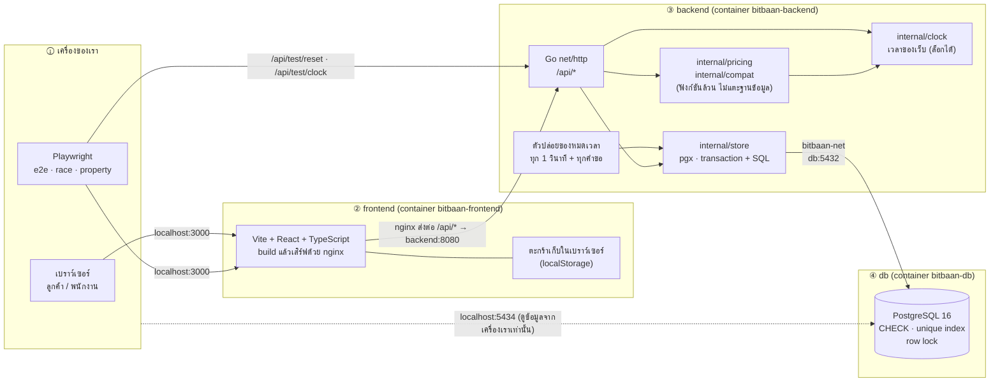

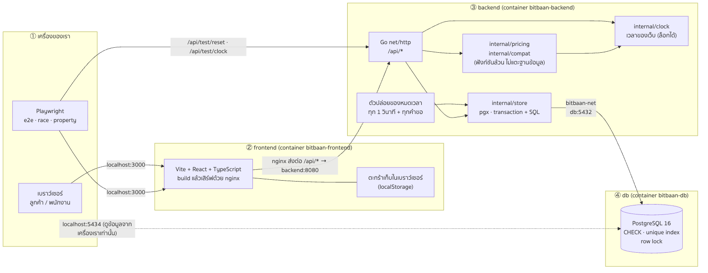

| ชั้น | อยู่ที่ไหน | หน้าที่ | ทดสอบด้วยอะไร |
| --- | --- | --- | --- |
| หน้าเว็บ | `frontend/` → container `bitbaan-frontend` (nginx) | แสดงสินค้า หน้าจัดสเปก ตะกร้า นับถอยหลัง (ตัวเลขมาจากเวลาของเว็บ NFR-16) · ตะกร้าอยู่ในเบราว์เซอร์ ราคาคิดที่ backend ทุกครั้ง | Playwright 3 เบราว์เซอร์ |
| API | `backend/` → container `bitbaan-backend` | รับคำสั่ง กดสั่ง จ่ายเงิน ยกเลิก คืนของ หลังร้าน · คำขอทดสอบ `/api/test/*` · รูปแบบตาม `API-CONTRACT.md` | Playwright `request` · `contract.spec.ts` |
| `internal/pricing` `internal/compat` | `backend/` | คิดเงินตามลำดับ G1 → G4 และตรวจความเข้ากันได้ · ฟังก์ชันล้วน รับเวลาเป็นพารามิเตอร์ | `go test` ด้วยตาราง quote ใน `TEST-DATA.md` + oracle อิสระ (การบ้านขั้น 3) |
| `internal/clock` | `backend/` | คืน "เวลาตอนนี้" ของเว็บ · ปกติใช้เวลาจริง · ตอนทดสอบล็อกด้วย `POST /api/test/clock` | ตั้งเวลาแล้วตรวจราคา flash sale |
| ตัวปล่อยของ | `backend/` | เปลี่ยนออเดอร์รอจ่ายที่เกินเวลาเป็น "หมดเวลา" และคืนของ (FR-41) | เลื่อนเวลาไป 30:01 แล้วอ่านจำนวน |
| ฐานข้อมูล | container `bitbaan-db` | เก็บข้อมูล · **ด่านสุดท้ายกันขายเกิน** ด้วย CHECK และ unique index | race test 50 รอบ (ขั้น 2) · query ตรวจหลังทดสอบ |

- ทั้ง 3 container อยู่ใน `docker-compose.yml` เดียว และคุยกันผ่าน network `bitbaan-net` · backend ต่อฐานข้อมูลที่ `db:5432` · พอร์ต **5434** เปิดให้เครื่องเราดูข้อมูลเท่านั้น
- เบราว์เซอร์และ Playwright เข้าทางเดียวคือ `localhost:3000` · nginx ส่ง `/api/*` ต่อให้ backend จึงไม่มีปัญหา CORS
- `BUG_MODE` 0 / 1 / 2 อ่านจากตัวแปรสภาพแวดล้อมของ backend ตอบที่ `GET /api/test/bug-mode` และหน้าเว็บใส่ `<body data-bug-mode>` (NFR-10)
- `/api/test/*` และ header `X-Test-User` ใช้ได้เฉพาะเมื่อ `TEST_MODE=1`
- เปลี่ยนจาก Next.js ในบท 04 เป็น Vite + Go ตามที่ทีมตัดสินใจ ดู `CONSISTENCY.md`

---

## 2. Use Case

<!-- render: use-case -->
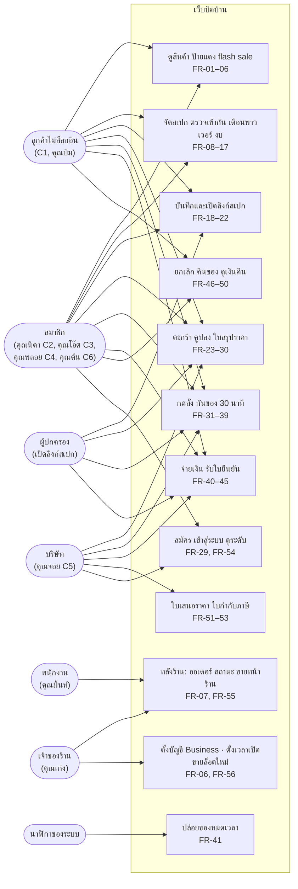

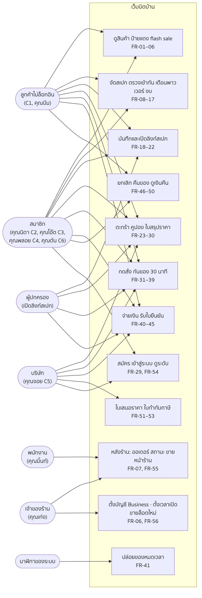

---

## 3. Flowchart

### 3.1 หน้าจัดสเปก: เลือกหรือเปลี่ยนชิ้น

<!-- render: flow-builder -->
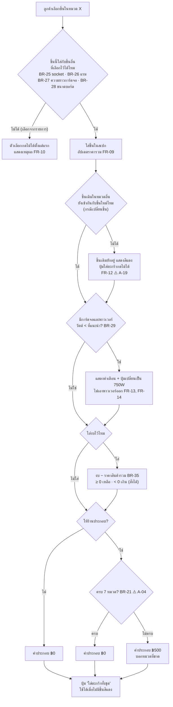

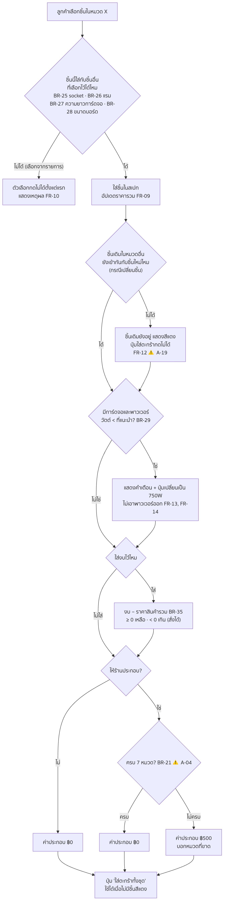

### 3.2 กดสั่ง กันของ จ่ายเงิน

<!-- render: flow-order -->
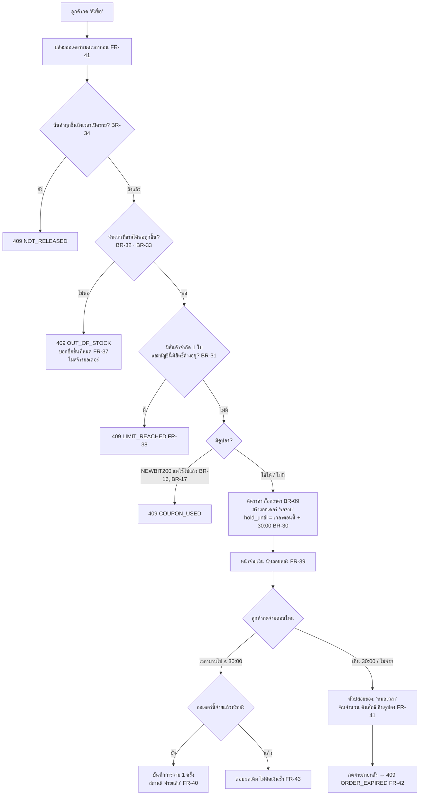

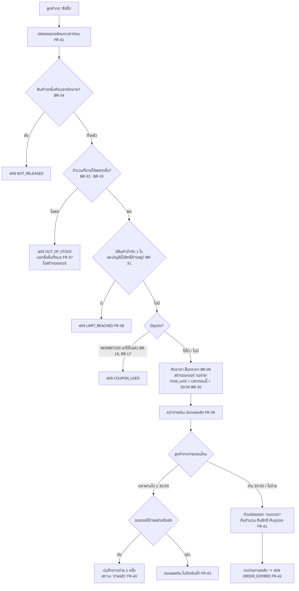

### 3.3 คำนวณราคาสุทธิตามลำดับของร้าน

ลำดับนี้เป็นสมมติฐาน ⚠️ A-10 (มีแค่ "สมาชิกก่อนคูปอง" ที่ร้านพูดเอง บ.22) · ทุกส่วนลด % ปัดส่วนลดลงเป็นบาทเต็ม ⚠️ A-11

<!-- render: flow-price -->
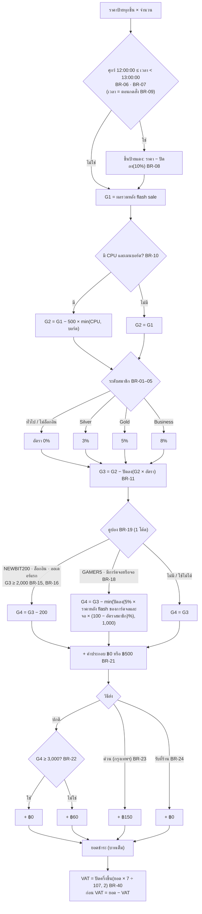

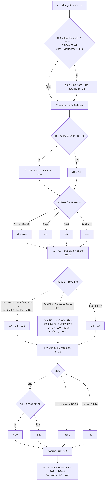

**ตัวอย่าง** คุณโอ๊ต (Silver) ศุกร์ 13 พ.ย. 12:30 · CPU-N5 + MB-B6 ส่งปกติ

| ขั้น | วิธีคิด | ยอด |
| --- | --- | ---: |
| ราคาป้าย | 6,290 + 4,590 | 10,880 |
| G1 | MB-B6 ป้ายแดง − 459 | 10,421 |
| G2 | − 500 × 1 | 9,921 |
| G3 | 9,921 × 3% = 297.63 → − 297 | 9,624 |
| G4 | ไม่มีคูปอง | 9,624 |
| ค่าส่ง | 9,624 ≥ 3,000 | 0 |
| **ยอดชำระ** | | **9,624** |
| VAT | 9,624 × 7 ÷ 107 = 629.607… | 629.61 |

### 3.4 ยกเลิกและคืนของ

<!-- render: flow-cancel-return -->
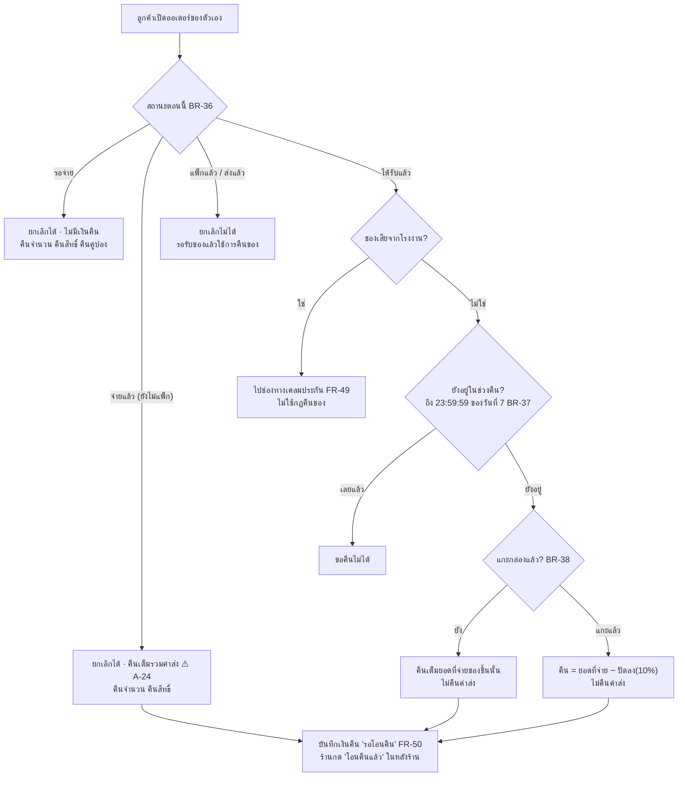

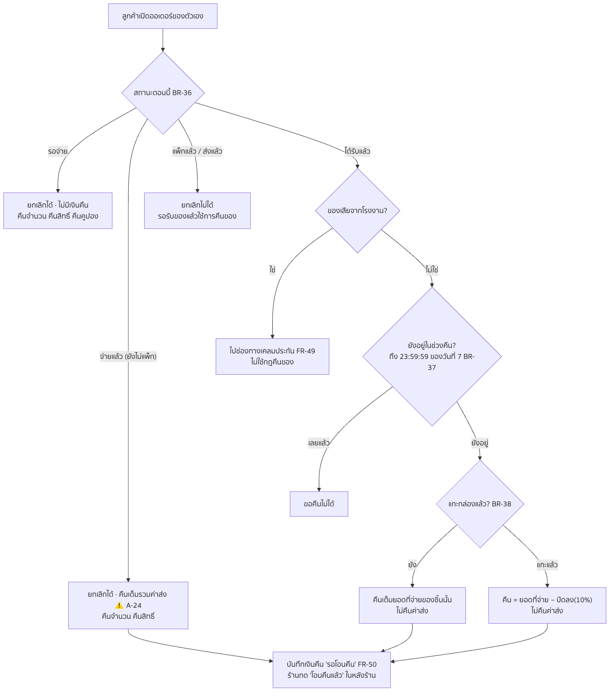

---

## 4. ERD

<!-- render: erd -->
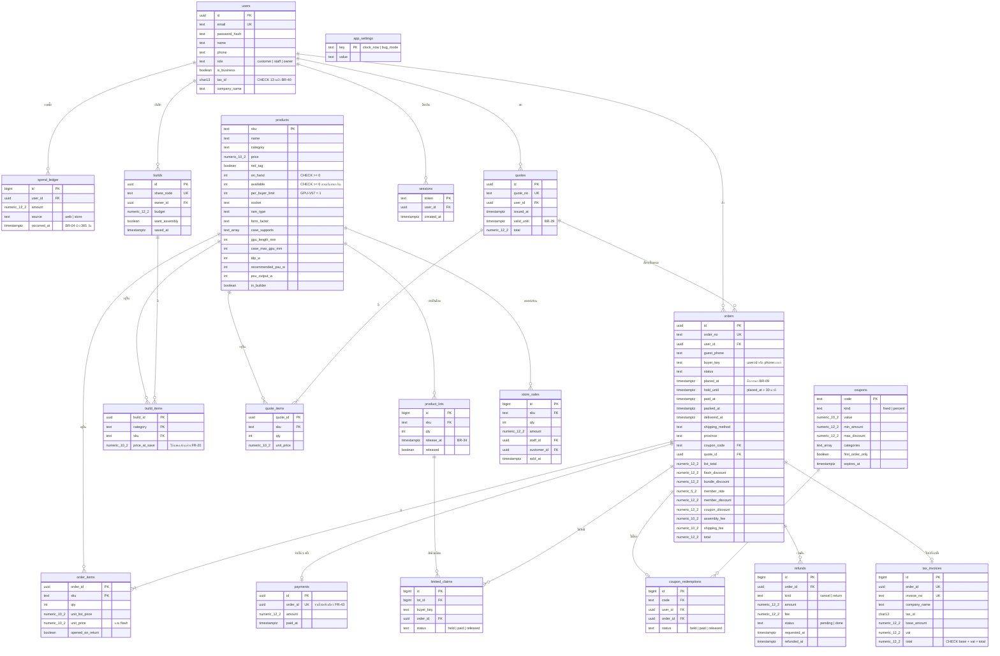

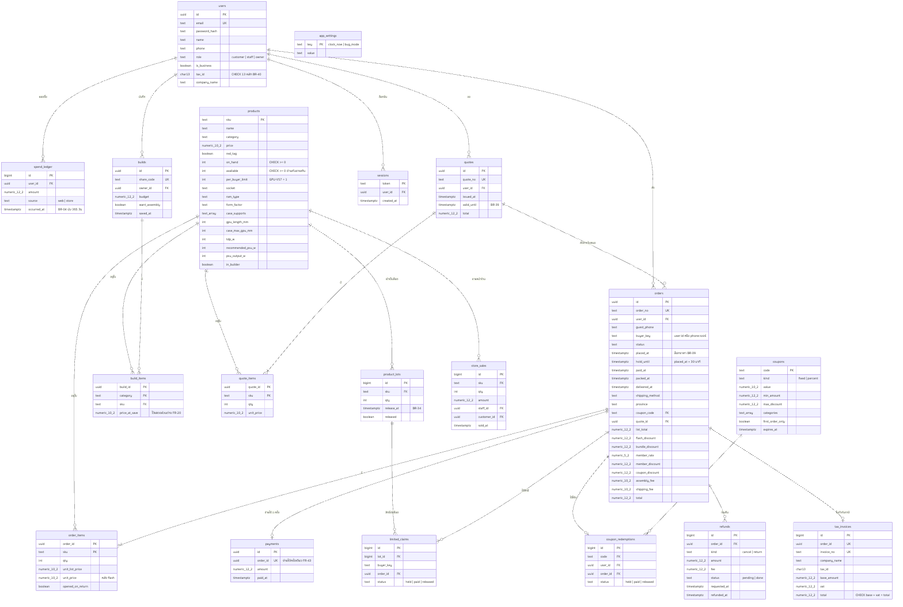

**ตะกร้า:** อยู่ใน localStorage ของเบราว์เซอร์ ไม่มีตารางในฐานข้อมูล ราคาคิดใหม่ที่ backend ทุกครั้งที่เปิดตะกร้าและตอนกดสั่ง จึงไม่มีราคาค้างในตะกร้า

**เงิน:** ทุกคอลัมน์เงินใช้ `NUMERIC(12,2)` หรือ `NUMERIC(10,2)` ไม่ใช้ float · ในโค้ดคิดเป็นหน่วยสตางค์ (จำนวนเต็ม) แล้วแปลงกลับตอนแสดง (NFR-05) · Mermaid เขียนชนิดข้อมูลเป็น `numeric_12_2` เพราะใส่วงเล็บไม่ได้

### กลไกกันขายเกินและกันสิทธิ์ซ้ำ (ที่ชั้นข้อมูล)

```sql
-- 1) จำนวนที่ขายได้ห้ามติดลบ (BR-32): ด่านสุดท้าย แม้โค้ดเว็บมีบั๊ก
ALTER TABLE products ADD CONSTRAINT available_not_negative CHECK (available >= 0);

-- 2) กันของแบบมีเงื่อนไขในคำสั่งเดียว (ไม่ใช่เช็กก่อนแล้วค่อยบันทึก)
UPDATE products SET available = available - $qty
 WHERE sku = $sku AND available >= $qty
RETURNING available;          -- ได้ 0 แถว = ของไม่พอ → ROLLBACK ทั้งออเดอร์ (FR-36)

-- 3) คนละ 1 ใบต่อล็อต (BR-31): 2 แท็บพร้อมกัน แท็บที่ 2 ชน unique → 409
CREATE UNIQUE INDEX one_claim_per_buyer_per_lot
  ON limited_claims (lot_id, buyer_key) WHERE status IN ('held', 'paid');

-- 4) NEWBIT200 ครั้งเดียวต่อบัญชี (BR-17)
CREATE UNIQUE INDEX one_first_order_coupon
  ON coupon_redemptions (user_id) WHERE code = 'NEWBIT200' AND status IN ('held', 'paid');

-- 5) จ่ายได้ครั้งเดียวต่อออเดอร์ (FR-43)
ALTER TABLE payments ADD CONSTRAINT one_payment_per_order UNIQUE (order_id);
```

- คำสั่ง 2 ใช้ row lock ของ PostgreSQL: คำขอที่มาพร้อมกันต้องรอกันทีละคำขอที่แถวสินค้าเดียวกัน คำขอที่มาทีหลังเห็นจำนวนล่าสุดเสมอ
- ออเดอร์หลายชิ้น lock แถวสินค้าเรียงตาม `sku` เสมอ เพื่อกัน deadlock เมื่อ 2 ออเดอร์มีสินค้าชุดเดียวกันคนละลำดับ
- ขายหน้าร้าน (FR-07) ใช้คำสั่ง 2 ชุดเดียวกัน หน้าร้านกับเว็บจึงแย่งของกันได้อย่างปลอดภัย (US-03)

---

## 5. Sequence

### 5.1 ลูกค้ากดสั่งและจ่ายเงิน

<!-- render: seq-order -->
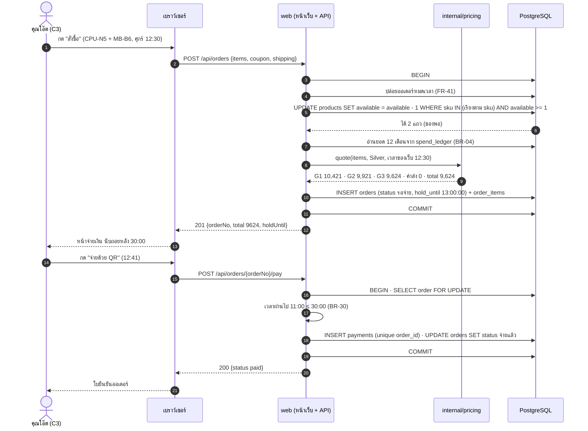

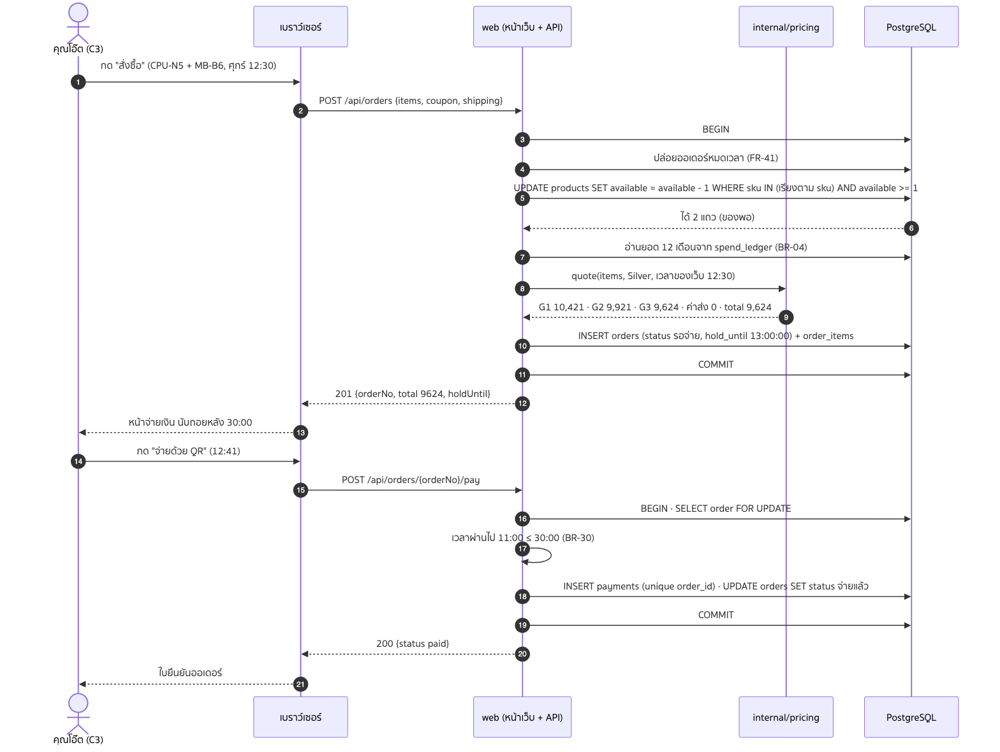

### 5.2 GPU-V57 เหลือ 1 ใบ 2 คนกดสั่งพร้อมกัน

<!-- render: seq-race -->
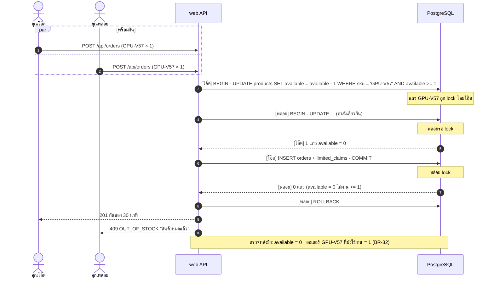

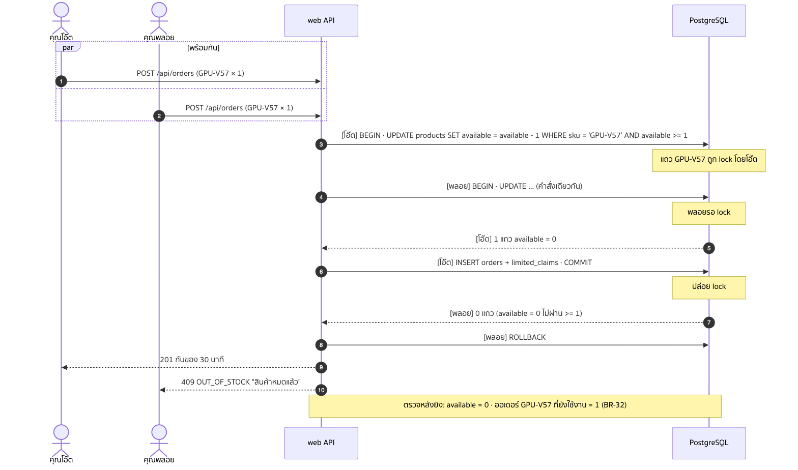

### 5.3 บัญชีเดียวกัน 2 แท็บ กดสั่ง GPU-V57 พร้อมกัน (ของยังมี 2 ใบ)

<!-- render: seq-limit -->
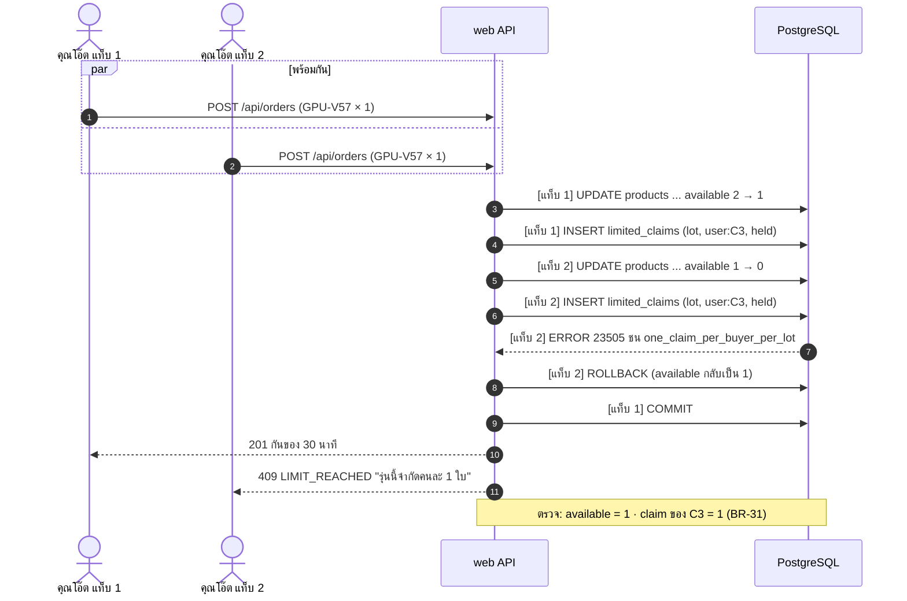

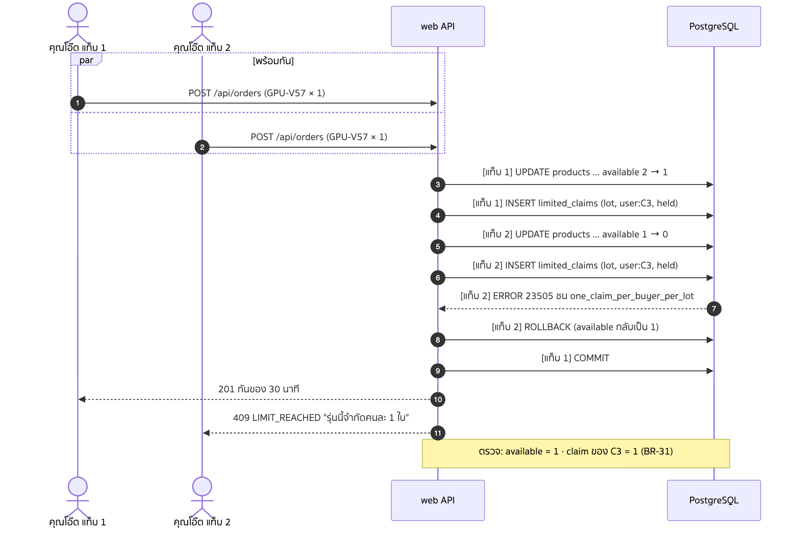

### 5.4 ไม่จ่ายใน 30 นาที ระบบปล่อยของคืน

<!-- render: seq-expire -->
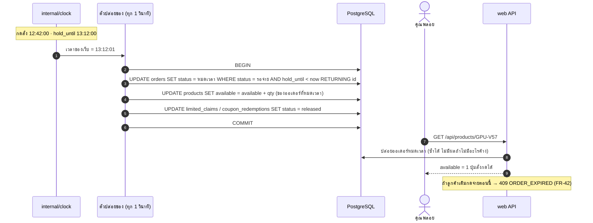


- ใช้ `hold_until < now` จึงยังจ่ายได้ที่ 30:00 พอดี (⚠️ A-17) และปล่อยของที่ 30:01
- ตัวปล่อยของรันทุก 1 วินาที **และ** ทุกคำขอที่อ่านจำนวนสินค้า ทำให้ผลไม่ขึ้นกับว่ามีคนเปิดเว็บไหม (NFR-11) และ test ที่เลื่อนเวลาเห็นผลทันทีโดยไม่ต้องรอ

---

## 6. คำถามที่ได้จากการออกแบบ

### ต้องถามร้าน

| รหัส | คำถาม | เจอตอนวาด | กระทบ |
| --- | --- | --- | --- |
| D-01 | ถ้าลูกค้ากดจ่ายตอน 29:59 แต่ธนาคารยืนยันตอน 30:05 นับว่าทันไหม | Sequence 5.1 | BR-30 |
| D-02 | ขายหน้าร้านให้สมาชิก ต้องบันทึกยอดเข้าบัญชีสมาชิกไหม ใครเป็นคนผูก | ERD `store_sales.customer_id` | BR-04 |
| D-03 | ของล็อตใหม่ 2 ใบ เข้ามาตอนที่ล็อตเก่ายังมีคนกันของค้างอยู่ สิทธิ์คนละ 1 ใบนับรวมล็อตเก่าไหม | ERD `product_lots` | BR-31 |
| D-04 | ยกเลิกออเดอร์ที่ใช้ NEWBIT200 แล้ว ได้โค้ดคืนไหม | Flowchart 3.4 | BR-16 |
| D-05 | คืนของ 1 ชิ้นจากออเดอร์ที่ได้ส่วนลดชุดประกอบ ต้องหักส่วนลดชุดประกอบคืนไหม | Flowchart 3.4 | BR-10, BR-38 |
| D-06 | คืนของแล้ว ยอดซื้อ 12 เดือนลดลงด้วยไหม ถ้าลดจนหลุด Silver ทำอย่างไรกับออเดอร์ที่ได้ 3% ไปแล้ว | ERD `spend_ledger` | BR-04 |
| D-07 | ใบเสนอราคาที่ออกในช่วง flash sale ได้ราคา flash ไหม | Flowchart 3.3 | BR-39 |
| D-08 | ผู้ปกครองจ่ายจากลิงก์สเปกของลูกที่ไม่ล็อกอิน ใบเสร็จออกชื่อใคร | Use Case | FR-22 |
| D-09 | พนักงานเปลี่ยนสถานะย้อนหลังได้ไหม เช่น กด "แพ็กแล้ว" ผิด | Flowchart 3.4 | BR-36 |

### ทีมตัดสินใจเอง

| รหัส | เรื่อง | ตัดสินใจ | เหตุผล |
| --- | --- | --- | --- |
| T-01 | กันขายเกิน | `UPDATE ... WHERE available >= qty` + `CHECK` | ไม่ต้องเช็กก่อนแล้วค่อยบันทึก จึงไม่มีช่องว่างให้คำขอแทรก |
| T-02 | ลำดับ lock | เรียงตาม `sku` | กัน deadlock ตอน 2 ออเดอร์มีของชุดเดียวกัน |
| T-03 | เวลาของเว็บ | `internal/clock` อ่าน `app_settings.clock_now` ถ้ามี | ทดสอบ flash sale และ 30 นาทีได้โดยไม่ต้องรอจริง |
| T-04 | คิดเงิน | `internal/pricing` เป็นฟังก์ชันล้วน ใช้สตางค์เป็นจำนวนเต็ม | ทดสอบด้วย unit และ property test ได้ เทียบ oracle ได้ |
| T-05 | ปล่อยของหมดเวลา | ทุก 1 วินาที + ทุกคำขอ | ไม่ต้องพึ่ง cron ภายนอก และ test เห็นผลทันที |
| T-06 | `buyer_key` | `user:<id>` หรือ `phone:<เบอร์>` | ใช้ unique index เดียวกันได้ทั้งสมาชิกและคนไม่ล็อกอิน (A-18) |
| T-07 | ราคาในออเดอร์ | เก็บทุกขั้น (flash, ชุดประกอบ, สมาชิก, คูปอง) ในออเดอร์ | ใบสรุปราคาและใบกำกับภาษีย้อนดูได้ แม้ราคาป้ายเปลี่ยนทีหลัง |

### FR / BR ที่ยังไม่อยู่ในแผนภาพใด

- FR-02 (ข้อความ "ราคารวม VAT แล้ว"), FR-33 (เวลาเปิดร้าน), FR-49 (ลิงก์เคลมประกัน) เป็นข้อความบนหน้าเว็บ ไม่มีทางแยกให้วาด · ตรวจใน TEST-PLAN ด้วยการดูหน้าจอ
- BR ครบทุกข้อ 40/40
