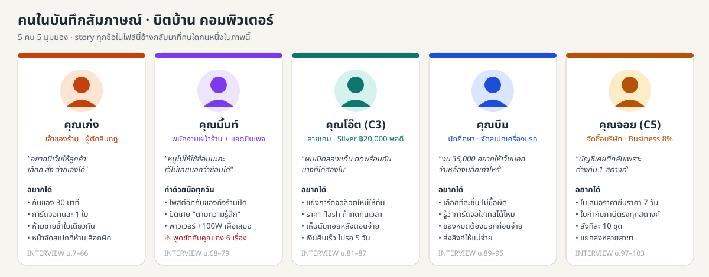
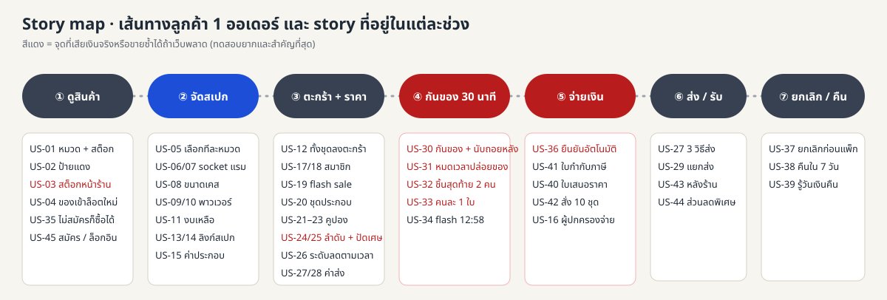
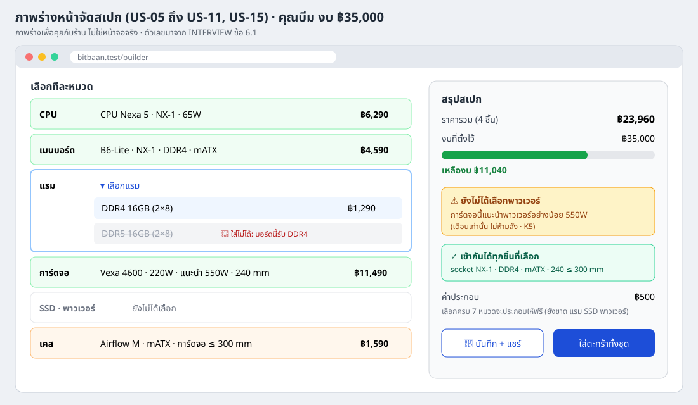
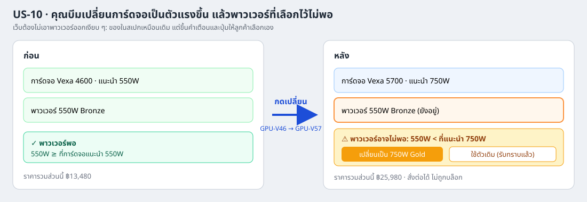
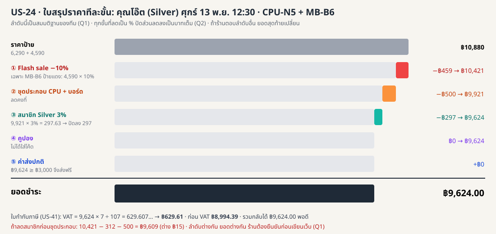
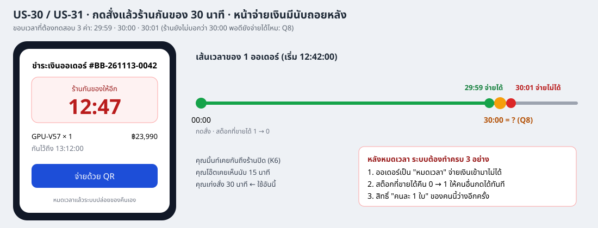
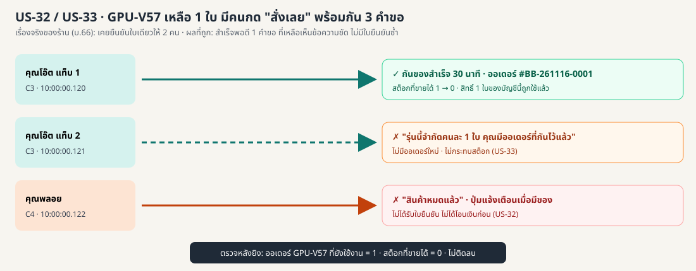
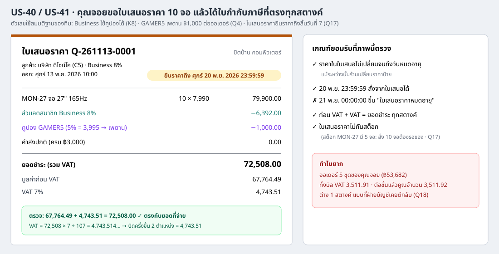

# User Stories · บิตบ้าน คอมพิวเตอร์

ที่มา: `INTERVIEW.md` (สัมภาษณ์ศุกร์ 6 พ.ย. 2026 + ข้อมูลที่ร้านยืนยันเพิ่มข้อ 6) · ร้านยังไม่ได้ตอบคำถามรอบแรก

## วิธีอ่าน

- **Must** = ขาดแล้วเปิดเว็บไม่ได้ หรือผิดกฎที่ร้านสั่ง หรือทำให้เสียเงินจริง
- **Should** = สำคัญ แต่ช่วงแรกยังใช้วิธีอื่นแทนได้ เช่น ทักแชตหรือทำที่หน้าร้าน
- **Could** = มีแล้วดี ยังไม่มีก็เปิดเว็บได้
- **ทดสอบยาก** ★ ตรวจหน้าจอครั้งเดียวก็รู้ · ★★ ต้องเตรียมข้อมูลหรือคิดเงินหลายขั้น · ★★★ ต้องคุมเวลา คนกดพร้อมกัน หรือคิดเงินที่ลำดับเปลี่ยนแล้วยอดเปลี่ยน
- **บ.12** = บรรทัด 12 ใน `INTERVIEW.md` · **ข้อ 6.1** = หัวข้อข้อมูลที่ร้านยืนยันเพิ่ม
- **(ทีมเสนอ)** = ตัวเลขหรือพฤติกรรมที่ทีมคิดเองให้ตรวจได้ ร้านยังไม่ได้พูด ต้องยืนยันก่อน
- **K1, K2, …** = คนพูดขัดกัน · **S1, S2, …** = วิธีทำด้วยมือที่ระบบทำแบบเดิมไม่ได้ · **Q1, Q2, …** = คำถามที่ต้องถามร้าน (อยู่ท้ายไฟล์)
- ความสำคัญทุกข้อเป็นการจัดของทีมเอง ร้านยังไม่ได้ยืนยัน

## สรุปภาพรวม

| ความสำคัญ | จำนวน | ★★★ | ★★ | ★ |
| --- | ---: | ---: | ---: | ---: |
| Must | 32 | 14 | 11 | 7 |
| Should | 10 | 4 | 4 | 2 |
| Could | 3 | 0 | 2 | 1 |
| **รวม** | **45** | **18** | **17** | **10** |

| รหัส | เรื่อง | ใครขอ | ความสำคัญ | ทดสอบยาก |
| --- | --- | --- | --- | --- |
| US-01 | ดูสินค้าตามหมวด ราคารวม VAT และจำนวนที่เหลือ | คุณเก่ง | Must | ★ |
| US-02 | เห็นป้ายแดงและราคา flash sale ตามเวลา | คุณเก่ง | Must | ★★ |
| US-03 | ขายหน้าร้านแล้วจำนวนในเว็บลดทันที | คุณมิ้นท์, คุณเก่ง | Must | ★★★ |
| US-04 | การ์ดจอล็อตใหม่เปิดขายตรงเวลาที่ประกาศ | คุณเก่ง | Should | ★★ |
| US-05 | จัดสเปกทีละหมวด เห็นราคารวมทันที | คุณเก่ง, คุณบีม | Must | ★ |
| US-06 | ห้ามเลือก CPU กับเมนบอร์ดคนละ socket | คุณเก่ง | Must | ★★ |
| US-07 | ห้ามเลือกแรมคนละแบบกับเมนบอร์ด | คุณเก่ง | Must | ★★ |
| US-08 | รู้ก่อนว่าการ์ดจอและเมนบอร์ดใส่เคสได้ไหม | คุณบีม | Must | ★★ |
| US-09 | เตือนเมื่อพาวเวอร์ไม่พอ | คุณเก่ง | Must | ★★ |
| US-10 | เปลี่ยนการ์ดจอแล้วพาวเวอร์ไม่พอ ต้องไม่หายเงียบ ๆ | คุณบีม | Must | ★★★ |
| US-11 | ตั้งงบแล้วเห็นงบที่เหลือ | คุณบีม | Should | ★ |
| US-12 | ใส่ตะกร้าทั้งชุด ของหมดต้องบอกก่อนจ่าย | คุณบีม | Must | ★★★ |
| US-13 | บันทึกสเปกแล้วส่งลิงก์ให้คนอื่นดู | คุณเก่ง, คุณบีม | Should | ★★ |
| US-14 | เปิดลิงก์สเปกทีหลัง เห็นราคาที่เปลี่ยน | คุณบีม | Should | ★★★ |
| US-15 | ค่าประกอบ ฿500 และฟรีเมื่อจัดครบชุด | คุณเก่ง, คุณมิ้นท์ | Must | ★★ |
| US-16 | ผู้ปกครองเปิดลิงก์แล้วจ่ายแทนได้ | คุณเก่ง | Could | ★★ |
| US-17 | ส่วนลดสมาชิก Silver 3% / Gold 5% จากยอด 12 เดือน | คุณเก่ง | Must | ★★ |
| US-18 | สมาชิก Business ลด 8% | คุณเก่ง, คุณจอย | Must | ★ |
| US-19 | Flash sale ศุกร์ 12:00–13:00 ป้ายแดงลด 10% | คุณเก่ง | Must | ★★★ |
| US-20 | ซื้อ CPU กับเมนบอร์ดคู่กันลด ฿500 | คุณเก่ง | Must | ★★★ |
| US-21 | คูปอง NEWBIT200 สำหรับออเดอร์แรก | คุณเก่ง | Must | ★★★ |
| US-22 | คูปอง GAMER5 เฉพาะการ์ดจอและจอ ลดสูงสุด ฿1,000 | คุณเก่ง, คุณจอย | Must | ★★ |
| US-23 | ใช้ได้ออเดอร์ละ 1 โค้ด และโค้ดหมดอายุใช้ไม่ได้ | คุณเก่ง | Must | ★ |
| US-24 | เห็นใบสรุปราคาทีละขั้นตามลำดับของร้าน | คุณเก่ง | Must | ★★★ |
| US-25 | ปัดเศษสตางค์แบบเดียวกันทุกครั้ง | คุณมิ้นท์, คุณจอย | Must | ★★★ |
| US-26 | ระดับสมาชิกลดลงเมื่อยอดเก่าเกิน 12 เดือน | คุณเก่ง | Should | ★★★ |
| US-27 | เลือกส่งปกติ ส่งด่วน หรือรับที่ร้าน เห็นค่าส่งก่อนจ่าย | คุณเก่ง | Must | ★ |
| US-28 | ส่งฟรีเมื่อซื้อครบ ฿3,000 | คุณเก่ง | Must | ★★ |
| US-29 | แยกส่งหลายที่อยู่ | คุณจอย | Could | ★★ |
| US-30 | กดสั่งแล้วร้านกันของ 30 นาที พร้อมนับถอยหลัง | คุณเก่ง, คุณโอ๊ต | Must | ★★★ |
| US-31 | ไม่จ่ายใน 30 นาที ปล่อยของคืนให้คนอื่น | คุณเก่ง | Must | ★★★ |
| US-32 | ของชิ้นสุดท้าย คนกดพร้อมกันได้คนเดียว | คุณเก่ง, คุณโอ๊ต | Must | ★★★ |
| US-33 | การ์ดจอรุ่นใหม่จำกัดคนละ 1 ใบ แม้เปิดหลายแท็บ | คุณเก่ง, คุณโอ๊ต | Must | ★★★ |
| US-34 | ราคา flash sale เมื่อกดก่อน 13:00 แต่จ่ายหลัง 13:00 | คุณโอ๊ต | Should | ★★★ |
| US-35 | สั่งซื้อได้โดยไม่สมัครสมาชิก | คุณเก่ง | Must | ★ |
| US-36 | จ่ายเงินแล้วได้ใบยืนยันทันที ไม่ต้องรอแอดมิน | คุณเก่ง, คุณโอ๊ต | Must | ★★★ |
| US-37 | ยกเลิกก่อนร้านแพ็ก ได้เงินคืนเต็ม | คุณเก่ง | Must | ★★ |
| US-38 | คืนของภายใน 7 วัน แกะกล่องแล้วหัก 10% | คุณเก่ง | Should | ★★★ |
| US-39 | รู้ว่าเงินคืนจะเข้าเมื่อไหร่ | คุณโอ๊ต | Should | ★ |
| US-40 | ใบเสนอราคายืนราคา 7 วัน | คุณจอย | Should | ★★ |
| US-41 | ใบกำกับภาษีแยก VAT ตรงกับยอดจ่ายทุกสตางค์ | คุณจอย | Must | ★★★ |
| US-42 | สั่งหลายชุดในออเดอร์เดียว | คุณจอย | Should | ★★ |
| US-43 | หลังร้านดูออเดอร์และเปลี่ยนสถานะ | คุณเก่ง, คุณมิ้นท์ | Must | ★★ |
| US-44 | ส่วนลดพิเศษให้ลูกค้าประจำ | คุณมิ้นท์ | Could | ★ |
| US-45 | สมัครสมาชิกและเข้าสู่ระบบด้วยอีเมล | คุณเก่ง | Must | ★ |

---

## A. ดูสินค้าและจำนวนที่เหลือ

### US-01 · ดูสินค้าตามหมวด · `Must` · ★

ในฐานะลูกค้า ฉันอยากดูสินค้าแยกตามหมวด พร้อมราคาและจำนวนที่เหลือ เพื่อเลือกของได้เองโดยไม่ต้องทักแชตถามแอดมิน

- **ใครขอ:** คุณเก่ง (บ.11, บ.12)
- **เกณฑ์ยอมรับ**
  1. มีหมวด 8 หมวดตาม บ.12 และสินค้า 15 รายการตามข้อ 6.1 ราคาตรงตาราง เช่น CPU-N5 แสดง ฿6,290
  2. ราคาที่แสดงคือราคาที่จ่ายจริง มีข้อความ "รวม VAT แล้ว" ไม่มีการบวก VAT เพิ่มทีหลัง (บ.13)
  3. สินค้าที่เหลือ 0 ชิ้น ขึ้น "สินค้าหมด" และกดใส่ตะกร้าไม่ได้

### US-02 · เห็นป้ายแดงและราคา flash sale · `Must` · ★★

ในฐานะลูกค้าที่รอ flash sale ฉันอยากเห็นว่าสินค้าไหนป้ายแดง และราคาลดตอนนี้เท่าไร เพื่อมาซื้อให้ทันช่วงเที่ยงวันศุกร์

- **ใครขอ:** คุณเก่ง (บ.26, บ.27)
- **เกณฑ์ยอมรับ**
  1. สินค้าป้ายแดง 4 รายการตามข้อ 6.1 (MB-B6, RAM-32, GPU-V46, SSD-1T) มีป้ายแดงทุกเวลา
  2. ศุกร์ 13 พ.ย. 2026 เวลา 12:00:00 ราคา MB-B6 เปลี่ยนจาก ฿4,590 เป็น ฿4,131 พร้อมราคาเดิมขีดฆ่า · เวลา 11:59:59 ยังเป็น ฿4,590
  3. สินค้าที่ไม่ใช่ป้ายแดง เช่น CPU-N5 ราคาไม่เปลี่ยนในช่วง flash sale
- **ทำไมยาก:** ต้องล็อกเวลาของเว็บให้เป็นวันศุกร์เที่ยงได้ ไม่งั้นทดสอบได้สัปดาห์ละ 1 ชั่วโมง

### US-03 · ขายหน้าร้านแล้วจำนวนในเว็บลดทันที · `Must` · ★★★

ในฐานะพนักงานหน้าร้าน ฉันอยากบันทึกของที่ขายหน้าตู้ลงระบบเดียวกับเว็บ เพื่อไม่ให้ลูกค้าออนไลน์สั่งของที่ไม่มีแล้ว

- **ใครขอ:** คุณมิ้นท์ (บ.74) · ที่มาของปัญหาคือ คุณเก่ง (บ.66)
- **เกณฑ์ยอมรับ**
  1. GPU-V46 เหลือ 4 · พนักงานบันทึกขายหน้าร้าน 1 ใบ → หน้าเว็บแสดงเหลือ 3 ทันทีที่เปิดหน้าใหม่
  2. ถ้าเหลือ 1 และพนักงานบันทึกขายหน้าร้านพร้อมกับลูกค้าออนไลน์กดสั่ง ต้องสำเร็จแค่ฝ่ายเดียว อีกฝ่ายเห็นว่า "สินค้าหมด"
  3. ขายหน้าร้านเกินจำนวนที่ขายได้ไม่ได้ (ของที่ถูกกันให้ลูกค้าออนไลน์ไม่นับว่าขายได้)
- **ทำไมยาก:** เป็นการแย่งของข้ามช่องทาง หน้าร้านกับเว็บ ต้องทดสอบตอนเกิดพร้อมกัน
- **เกี่ยวกับ:** S1

### US-04 · การ์ดจอล็อตใหม่เปิดขายตรงเวลา · `Should` · ★★

ในฐานะเจ้าของร้าน ฉันอยากตั้งเวลาเปิดขายของล็อตใหม่ล่วงหน้า เพื่อให้ทุกคนเริ่มกดพร้อมกันตามที่ประกาศในเพจ

- **ใครขอ:** คุณเก่ง (บ.14) · ข้อมูลข้อ 6.5
- **เกณฑ์ยอมรับ**
  1. GPU-V57 ล็อตใหม่ 2 ใบ เปิดขาย จันทร์ 16 พ.ย. 2026 10:00:00 · เวลา 09:59:59 ปุ่มสั่งยังกดไม่ได้และแสดงเวลาเปิดขาย (ทีมเสนอ, Q22)
  2. เวลา 10:00:00 จำนวนที่ขายได้เพิ่มเป็น 2 ใบ และกดสั่งได้

---

## B. จัดสเปกเองทีละชิ้น

### US-05 · จัดสเปกทีละหมวด เห็นราคารวมทันที · `Must` · ★

ในฐานะลูกค้าที่ไม่อยากได้ชุดสำเร็จ ฉันอยากเลือก CPU เมนบอร์ด แรม การ์ดจอ SSD พาวเวอร์ และเคสทีละหมวด เพื่อได้เครื่องที่ตรงกับที่ฉันต้องการ

- **ใครขอ:** คุณเก่ง (บ.41), คุณบีม (บ.91)
- **เกณฑ์ยอมรับ**
  1. หน้าจัดสเปกมี 7 หมวดตาม บ.41 เลือกได้หมวดละ 1 ชิ้น · จอ (MON-27) ไม่อยู่ในหน้านี้ (ข้อ 6.1)
  2. เลือก CPU-N5 + MB-B6 + GPU-V46 + CASE-M → ราคารวมขึ้น ฿23,960 ทันทีโดยไม่ต้องโหลดหน้าใหม่
  3. เปลี่ยนชิ้นในหมวดเดิม ราคารวมเปลี่ยนตาม ไม่บวกซ้ำ

### US-06 · ห้ามเลือก CPU กับเมนบอร์ดคนละ socket · `Must` · ★★

ในฐานะลูกค้ามือใหม่ ฉันอยากให้เว็บไม่ให้ฉันเลือก CPU กับเมนบอร์ดที่ใส่กันไม่ได้ เพื่อไม่ต้องซื้อของผิดแล้วต้องเอามาเปลี่ยน

- **ใครขอ:** คุณเก่ง (บ.42)
- **เกณฑ์ยอมรับ**
  1. เลือก CPU-N5 (NX-1) แล้ว MB-X7 (NX-2) กดเลือกไม่ได้ และมีเหตุผล "socket ไม่ตรง: CPU ใช้ NX-1"
  2. เลือกเมนบอร์ดก่อนก็ต้องห้ามแบบเดียวกัน: เลือก MB-X7 แล้ว CPU-N5 กดเลือกไม่ได้
  3. หน้าสินค้าปกติ (นอกหน้าจัดสเปก) ยังซื้อ MB-X7 ชิ้นเดียวได้ (ทีมเสนอ, K7)
- **เกี่ยวกับ:** K7

### US-07 · ห้ามเลือกแรมคนละแบบกับเมนบอร์ด · `Must` · ★★

ในฐานะลูกค้ามือใหม่ ฉันอยากให้เว็บห้ามแรมที่ใส่บอร์ดไม่ได้ เพื่อไม่ต้องรู้เองว่า DDR4 กับ DDR5 ต่างกันยังไง

- **ใครขอ:** คุณเก่ง (บ.42)
- **เกณฑ์ยอมรับ**
  1. เลือก MB-B6 (DDR4) → RAM-16 และ RAM-32 (DDR5) กดเลือกไม่ได้ · RAM-D4 เลือกได้
  2. ถ้าเลือก RAM-16 ไว้ก่อน แล้วเปลี่ยนเมนบอร์ดเป็น MB-B6 เว็บต้องบอกชัดว่าแรมที่เลือกไว้ใช้ไม่ได้แล้ว และไม่ให้ใส่ตะกร้าจนกว่าจะแก้ (ทีมเสนอ, Q10)

### US-08 · รู้ก่อนว่าการ์ดจอและเมนบอร์ดใส่เคสได้ไหม · `Must` · ★★

ในฐานะลูกค้าที่เพื่อนเคยซื้อการ์ดจอใส่เคสไม่ลง ฉันอยากรู้ก่อนจ่ายว่าการ์ดจอและเมนบอร์ดใส่เคสที่เลือกได้ เพื่อไม่ต้องเสียเงินซื้อเคสใหม่

- **ใครขอ:** คุณบีม (บ.93) · ข้อมูลข้อ 6.1
- **เกณฑ์ยอมรับ**
  1. GPU-V57 ยาว 310 mm กับ CASE-M (ไม่เกิน 300 mm) → เลือกด้วยกันไม่ได้ · GPU-V46 ยาว 240 mm เลือกได้
  2. MB-X7 (ATX) กับ CASE-M (รับแค่ mATX) → เลือกด้วยกันไม่ได้ · MB-X7 กับ CASE-L เลือกได้
  3. ⚠️ เป็นการห้ามหรือแค่เตือน ร้านยังไม่ได้บอก ทีมเสนอให้ห้ามแบบเดียวกับ socket เพราะใส่ไม่ลงจริง (Q11)

### US-09 · เตือนเมื่อพาวเวอร์ไม่พอ · `Must` · ★★

ในฐานะเจ้าของร้าน ฉันอยากให้เว็บเตือนเมื่อพาวเวอร์ไม่พอกับเครื่อง เพื่อลดเครื่องดับและการเคลมที่ไม่ใช่ของเสีย

- **ใครขอ:** คุณเก่ง (บ.43) · ข้อมูลข้อ 6.1 · คุณมิ้นท์ (บ.78)
- **เกณฑ์ยอมรับ**
  1. GPU-V46 (แนะนำ 550W) + PSU-550 → ไม่เตือน · GPU-V57 (แนะนำ 750W) + PSU-550 → ขึ้น "พาวเวอร์อาจไม่พอ: 550W < 750W"
  2. คำเตือนไม่บล็อก ลูกค้ายังใส่ตะกร้าได้ เพราะคุณเก่งพูดว่า "เตือน" ไม่ใช่ "ห้าม" (บ.43)
  3. ⚠️ เกณฑ์ "พอ" ใช้ตัวเลขแนะนำของการ์ดจอตามข้อ 6.1 ไม่บวกเผื่อ 100W แบบคุณมิ้นท์ (K5)
- **เกี่ยวกับ:** K5

### US-10 · เปลี่ยนการ์ดจอแล้วพาวเวอร์ไม่พอ · `Must` · ★★★

ในฐานะลูกค้าที่เปลี่ยนใจได้ตลอด ฉันอยากให้เว็บบอกเมื่อของที่เลือกไว้ก่อนไม่พอกับของใหม่ แต่ไม่ลบของฉันออกเอง เพื่อให้ฉันตัดสินใจเองว่าจะเปลี่ยนหรือไม่

- **ใครขอ:** คุณบีม (บ.92)
- **เกณฑ์ยอมรับ**
  1. สเปกมี GPU-V46 + PSU-550 → เปลี่ยนเป็น GPU-V57 → PSU-550 ยังอยู่ในสเปก ราคารวมส่วนนี้ ฿25,980 และขึ้นคำเตือนทันที
  2. คำเตือนมีปุ่ม "เปลี่ยนเป็น 750W" กดแล้วสเปกเป็น PSU-750 ราคาเพิ่ม ฿1,300 และคำเตือนหายไป
  3. เปลี่ยนกลับเป็น GPU-V46 คำเตือนหายเอง
- **ทำไมยาก:** ต้องทดสอบตามลำดับการกด ไม่ใช่สภาพสุดท้าย และต้องตรวจว่าไม่มีของหายเงียบ ๆ

### US-11 · ตั้งงบแล้วเห็นงบที่เหลือ · `Should` · ★

ในฐานะนักศึกษาที่มีงบจำกัด ฉันอยากใส่งบไว้แล้วเห็นว่าเหลืออีกเท่าไร เพื่อเลือกของให้ไม่เกินงบ

- **ใครขอ:** คุณบีม (บ.91)
- **เกณฑ์ยอมรับ**
  1. งบ ฿35,000 สเปกรวม ฿23,960 → "เหลืองบ ฿11,040"
  2. สเปกเกินงบ เช่นรวม ฿35,001 → "เกินงบ ฿1" เป็นสีแดง แต่ยังใส่ตะกร้าได้ (ทีมเสนอ)
  3. ⚠️ งบเทียบกับราคาสินค้าตอนนี้ (รวม flash sale) ก่อนส่วนลดชุดประกอบ สมาชิก และคูปอง ไม่รวมค่าประกอบ (ทีมเสนอ, Q13)

### US-12 · ใส่ตะกร้าทั้งชุด ของหมดต้องบอกก่อนจ่าย · `Must` · ★★★

ในฐานะลูกค้าที่จัดสเปกเสร็จแล้ว ฉันอยากกดใส่ตะกร้าทีเดียวทั้งชุด และถ้ามีชิ้นไหนหมดระหว่างนั้น ต้องบอกฉันก่อนจ่าย เพื่อไม่ได้ของไม่ครบโดยไม่รู้ตัว

- **ใครขอ:** คุณบีม (บ.94)
- **เกณฑ์ยอมรับ**
  1. สเปก 7 ชิ้นกด "ใส่ตะกร้าทั้งชุด" → ตะกร้ามีครบ 7 รายการ ราคาเท่ากับหน้าจัดสเปก
  2. ระหว่างที่อยู่หน้าตะกร้า GPU-V57 ถูกคนอื่นซื้อไปจนหมด → กดสั่งแล้วไม่สร้างออเดอร์ ขึ้นชื่อชิ้นที่หมด และให้เลือก "เอาชิ้นนี้ออก" หรือ "กลับไปเลือกใหม่"
  3. ไม่มีกรณีที่ออเดอร์ถูกสร้างโดยมีของน้อยกว่าที่ลูกค้าเห็นตอนกดสั่ง
- **ทำไมยาก:** ต้องให้อีกคนซื้อตัดหน้าในจังหวะที่ลูกค้าคนแรกยังอยู่หน้าตะกร้า

### US-13 · บันทึกสเปกแล้วส่งลิงก์ · `Should` · ★★

ในฐานะลูกค้าที่ให้ผู้ปกครองช่วยจ่าย ฉันอยากบันทึกสเปกแล้วได้ลิงก์ไปส่งให้คนอื่นดู เพื่อให้เขาเห็นของชุดเดียวกับที่ฉันเลือก

- **ใครขอ:** คุณเก่ง (บ.45), คุณบีม (บ.95)
- **เกณฑ์ยอมรับ**
  1. กด "บันทึกสเปก" ได้ลิงก์ เปิดลิงก์นั้นในเบราว์เซอร์อื่นที่ไม่ได้ล็อกอิน แล้วเห็นของครบ 7 ชิ้นเหมือนเดิม
  2. คนที่เปิดลิงก์แก้สเปกของเจ้าของไม่ได้ ถ้าแก้ต้องเป็นสเปกใหม่ของตัวเอง (ทีมเสนอ)

### US-14 · เปิดลิงก์สเปกทีหลัง เห็นราคาที่เปลี่ยน · `Should` · ★★★

ในฐานะผู้ปกครองที่เปิดลิงก์ช้าไปหลายวัน ฉันอยากรู้ว่าราคาตอนนี้ต่างจากตอนลูกบันทึกเท่าไร เพื่อไม่ตกใจตอนจ่าย

- **ใครขอ:** คุณบีม (บ.95)
- **เกณฑ์ยอมรับ**
  1. ⚠️ ราคาในลิงก์เป็นราคาปัจจุบัน ไม่ล็อกราคา (ทีมเสนอ, Q12)
  2. บันทึกวันพฤหัส 12 พ.ย. ราคา GPU-V46 ฿11,490 · เปิดลิงก์ตอนศุกร์ 13 พ.ย. 12:30 → เห็น ฿10,341 และข้อความ "ราคาเปลี่ยนจากตอนบันทึก −฿1,149"
  3. ถ้าชิ้นไหนหมดตอนเปิดลิงก์ ขึ้นว่า "หมดแล้ว" ที่ชิ้นนั้น
- **ทำไมยาก:** ต้องเลื่อนเวลาของเว็บข้ามวันและข้ามช่วง flash sale

### US-15 · ค่าประกอบ ฿500 และฟรีเมื่อจัดครบชุด · `Must` · ★★

ในฐานะเจ้าของร้าน ฉันอยากคิดค่าประกอบ ฿500 แต่ประกอบให้ฟรีเมื่อลูกค้าจัดสเปกครบชุดกับร้าน เพื่อจูงใจให้ซื้อทั้งเครื่องที่ร้าน

- **ใครขอ:** คุณเก่ง (บ.44) · คุณมิ้นท์ (บ.79)
- **เกณฑ์ยอมรับ**
  1. ⚠️ "ครบชุด" = มีครบ 7 หมวดตาม บ.41 ในสเปกเดียว (ทีมเสนอ, K4)
  2. สเปก 7 หมวด + เลือก "ให้ร้านประกอบ" → ค่าประกอบ ฿0
  3. สเปก 6 หมวด (ไม่มีการ์ดจอ) + เลือก "ให้ร้านประกอบ" → ค่าประกอบ ฿500 · ไม่เลือกประกอบ → ฿0
- **เกี่ยวกับ:** K4

### US-16 · ผู้ปกครองเปิดลิงก์แล้วจ่ายแทน · `Could` · ★★

ในฐานะผู้ปกครอง ฉันอยากกดสั่งจากลิงก์สเปกที่ลูกส่งมาได้เลย เพื่อไม่ต้องให้ลูกเลือกใหม่

- **ใครขอ:** คุณเก่ง (บ.45 "เด็ก ๆ ชอบให้ผู้ปกครองจ่าย")
- **เกณฑ์ยอมรับ**
  1. หน้าลิงก์สเปกมีปุ่ม "ใส่ตะกร้าทั้งชุด" ใช้ได้ทั้งคนที่ล็อกอินและไม่ล็อกอิน
  2. ส่วนลดคิดตามบัญชีของคนที่จ่าย ไม่ใช่ของคนที่บันทึกสเปก (ทีมเสนอ, Q12)

---

## C. ราคา ส่วนลด และคูปอง

### US-17 · ส่วนลดสมาชิก Silver / Gold · `Must` · ★★

ในฐานะลูกค้าประจำ ฉันอยากได้ส่วนลดตามระดับสมาชิกจากยอดซื้อ 12 เดือนล่าสุด เพื่อคุ้มที่ซื้อกับร้านนี้ต่อ

- **ใครขอ:** คุณเก่ง (บ.18–20) · ข้อมูลข้อ 6.2
- **เกณฑ์ยอมรับ**
  1. ยอด ฿19,999 = ทั่วไป ไม่มีส่วนลด · ฿20,000 = Silver 3% (คุณโอ๊ต C3) · ฿99,999 = Silver · ฿100,000 = Gold 5%
  2. คุณพลอย (C4 ฿135,000) ซื้อ CPU-N7 ฿10,990 → ลดสมาชิก ฿549 (5% = 549.50 ปัดส่วนลดลง, Q2)
  3. ลูกค้าไม่ล็อกอิน (C1) ไม่เห็นและไม่ได้ส่วนลดสมาชิก
  4. หน้าบัญชีบอกยอดที่ขาดถึงระดับถัดไป: คุณโอ๊ต ฿20,000 → "อีก ฿80,000 เป็น Gold" (จากหน้าออกแบบ `design/Account.html`)

### US-18 · สมาชิก Business ลด 8% · `Must` · ★

ในฐานะฝ่ายจัดซื้อของบริษัท ฉันอยากได้ส่วนลด Business 8% ทุกออเดอร์ เพื่อคุมงบซื้อคอมให้พนักงาน

- **ใครขอ:** คุณเก่ง (บ.21), คุณจอย (บ.99)
- **เกณฑ์ยอมรับ**
  1. คุณจอย (C5) ซื้อ MON-27 ฿7,990 → ลดสมาชิก ฿639 (8% = 639.20 ปัดลง)
  2. ระดับ Business ไม่ขึ้นกับยอดสะสม: บริษัทสมัครเองวันนี้ด้วยเลขผู้เสียภาษี 13 หลัก ยอด ฿0 ก็ได้ 8% ทันที (บ.21 "สมัครแล้วได้เลย")
  3. บัญชีที่ไม่มีเลขผู้เสียภาษีตั้งเป็น Business ไม่ได้

### US-19 · Flash sale ศุกร์ 12:00–13:00 · `Must` · ★★★

ในฐานะเจ้าของร้าน ฉันอยากลดสินค้าป้ายแดง 10% ทุกวันศุกร์ 12:00–13:00 และสมาชิกได้ส่วนลดสมาชิกต่ออีก เพื่อให้ลูกค้ามาซื้อตอนเที่ยง

- **ใครขอ:** คุณเก่ง (บ.26, บ.27) · คุณมิ้นท์ (บ.72)
- **เกณฑ์ยอมรับ**
  1. ศุกร์ 13 พ.ย. 2026: 11:59:59 ไม่ลด · 12:00:00 ลด · 12:59:59 ลด · 13:00:00 ไม่ลด (ทีมเสนอ, Q7)
  2. พฤหัส 12 พ.ย. 12:30 ไม่ลด เพราะไม่ใช่วันศุกร์
  3. ⚠️ สมาชิกได้ทั้ง flash sale และส่วนลดสมาชิก ตามคุณเก่ง ไม่ใช่คุณมิ้นท์ (K2): คุณโอ๊ตซื้อ MB-B6 ศุกร์ 12:30 → ฿4,131 − 3% (฿123) = ฿4,008
- **เกี่ยวกับ:** K2

### US-20 · ชุดประกอบ CPU + เมนบอร์ด ลด ฿500 · `Must` · ★★★

ในฐานะลูกค้าที่ซื้อ CPU กับเมนบอร์ดพร้อมกัน ฉันอยากได้ส่วนลด ฿500 เพื่อคุ้มกว่าซื้อแยก

- **ใครขอ:** คุณเก่ง (บ.37) · คุณมิ้นท์ (บ.73)
- **เกณฑ์ยอมรับ**
  1. ⚠️ ใช้กฎคุณเก่ง: CPU 1 + เมนบอร์ด 1 ในออเดอร์เดียว ลด ฿500 ไม่ต้องมีแรม (K3)
  2. CPU-N5 + MB-B6 วันพฤหัส ลูกค้าทั่วไป → ฿10,880 − ฿500 = ฿10,380
  3. CPU อย่างเดียว หรือเมนบอร์ดอย่างเดียว → ไม่ลด
  4. ⚠️ CPU 5 + เมนบอร์ด 5 (คุณจอยสั่ง 5 ชุด) → ลด 5 × ฿500 = ฿2,500 (ทีมเสนอ, Q5)
- **ทำไมยาก:** กติกาเรื่องจำนวนชุดและลำดับการลด (ก่อนหรือหลังสมาชิก) เปลี่ยนยอดสุดท้าย
- **เกี่ยวกับ:** K3

### US-21 · คูปอง NEWBIT200 ออเดอร์แรก · `Must` · ★★★

ในฐานะลูกค้าใหม่ ฉันอยากได้ส่วนลด ฿200 กับออเดอร์แรกเมื่อซื้อครบ ฿2,000 เพื่อลองสั่งออนไลน์กับร้านครั้งแรก

- **ใครขอ:** คุณเก่ง (บ.31)
- **เกณฑ์ยอมรับ**
  1. คุณนิดา (C2) ยังไม่เคยสั่งออนไลน์ ซื้อ CPU-N5 ฿6,290 ใส่ NEWBIT200 → ลด ฿200 จ่าย ฿6,090
  2. ⚠️ ยอดที่ใช้เทียบ ฿2,000 คือยอดหลังส่วนลดอื่นก่อนคูปอง: ฿1,999 ใช้ไม่ได้ · ฿2,000 ใช้ได้ · ฿2,001 ใช้ได้ (ทีมเสนอ, Q3)
  3. บัญชีที่มีออเดอร์ที่จ่ายแล้วอย่างน้อย 1 ออเดอร์ ใส่โค้ดแล้วขึ้น "โค้ดนี้ใช้ได้กับออเดอร์แรกเท่านั้น"
  4. ⚠️ ลูกค้าไม่ล็อกอินใช้ไม่ได้ เพราะร้านพูดว่า "ของบัญชี" (Q3)
- **ทำไมยาก:** "ออเดอร์แรก" ต้องนิยามกรณีออเดอร์ที่ยกเลิกหรือหมดเวลา และกรณีกดสั่งพร้อมกัน 2 แท็บด้วยโค้ดเดียว

### US-22 · คูปอง GAMER5 · `Must` · ★★

ในฐานะคนซื้อการ์ดจอหรือจอ ฉันอยากใช้โค้ด GAMER5 ลด 5% เฉพาะของหมวดนั้น เพื่อซื้อของเล่นเกมได้ถูกลง

- **ใครขอ:** คุณเก่ง (บ.32), คุณจอย (บ.102)
- **เกณฑ์ยอมรับ**
  1. ลดเฉพาะการ์ดจอและจอ: ลูกค้าทั่วไป ตะกร้า GPU-V46 + CPU-N5 วันพฤหัส → ส่วนลดคิดจาก ฿11,490 เท่านั้น = ฿574
  2. ⚠️ สมาชิกคิด 5% จากราคาที่ลดสมาชิกแล้ว (บ.22 "สมาชิกก่อน แล้วค่อยคูปอง"): คุณโอ๊ต (Silver) MON-27 → 7,990 × 97% × 5% = 387.51 → ลด ฿387
  3. ส่วนลดไม่เกิน ฿1,000: GPU-V57 ฿23,990 × 5% = ฿1,199 → ลด ฿1,000
  4. ⚠️ คุณจอยสั่ง MON-27 10 จอ: 79,900 × 92% × 5% = ฿3,675 → ลด ฿1,000 เพราะเพดานต่อออเดอร์ (ทีมเสนอ, Q4)
  5. ตะกร้าไม่มีการ์ดจอหรือจอ ใส่ GAMER5 → "โค้ดนี้ใช้ได้เฉพาะการ์ดจอและจอ"
- **เกี่ยวกับ:** K8 (บริษัทใช้คูปองได้ไหม)

### US-23 · ออเดอร์ละ 1 โค้ด และโค้ดหมดอายุ · `Must` · ★

ในฐานะเจ้าของร้าน ฉันอยากให้ใช้คูปองได้ออเดอร์ละ 1 โค้ด และโค้ดหมดอายุใช้ไม่ได้ เพื่อไม่ให้ลดซ้อนเกินที่ตั้งใจ

- **ใครขอ:** คุณเก่ง (บ.33) · ข้อมูลข้อ 6.4
- **เกณฑ์ยอมรับ**
  1. ใส่ NEWBIT200 แล้วใส่ GAMER5 ต่อ → เว็บถามว่าจะเปลี่ยนเป็นโค้ดใหม่ไหม ไม่ใช้ 2 โค้ดพร้อมกัน
  2. `OLD2025` (หมดอายุ 31 ธ.ค. 2025) → "โค้ดหมดอายุแล้ว" ยอดไม่เปลี่ยน
  3. โค้ดที่ไม่มีอยู่จริง เช่น `FREE999` → "ไม่พบโค้ดนี้"

### US-24 · ใบสรุปราคาทีละขั้น · `Must` · ★★★

ในฐานะลูกค้า ฉันอยากเห็นว่ายอดสุดท้ายมาจากส่วนลดอะไรบ้าง ลดทีละเท่าไร เพื่อเชื่อว่าเว็บคิดถูก และไม่ต้องทักถามแอดมิน

- **ใครขอ:** คุณเก่ง (บ.22 "ลูกค้าจะได้รู้สึกว่าได้สองต่อ")
- **เกณฑ์ยอมรับ**
  1. หน้าตะกร้าและหน้าจ่ายเงินแสดงทีละบรรทัด: ราคาป้าย → flash sale → ชุดประกอบ → สมาชิก → คูปอง → ค่าประกอบ → ค่าส่ง → ยอดชำระ (ลำดับทีมเสนอ, Q1)
  2. ตัวอย่างในภาพด้านบน: คุณโอ๊ต ศุกร์ 12:30 CPU-N5 + MB-B6 → ฿9,624
  3. ⚠️ สมาชิกกับคูปองใช้ซ้อนกันได้ ตามคุณเก่ง ไม่ใช่คุณมิ้นท์ (K1)
  4. ทุกบรรทัดบวกลบกันแล้วได้ยอดชำระพอดี
- **ทำไมยาก:** ลำดับต่างกันยอดต่างกัน ถ้าลดสมาชิกก่อนชุดประกอบจะได้ ฿9,609 ต่างไป ฿15
- **เกี่ยวกับ:** K1, K2

### US-25 · ปัดเศษแบบเดียวกันทุกครั้ง · `Must` · ★★★

ในฐานะพนักงาน ฉันอยากให้ระบบปัดเศษส่วนลดตามกฎเดียวทุกครั้ง เพื่อไม่ต้องปัด "ตามความรู้สึก" แล้วลูกค้าแต่ละคนได้ไม่เท่ากัน

- **ใครขอ:** คุณมิ้นท์ (บ.76), คุณจอย (บ.101)
- **เกณฑ์ยอมรับ**
  1. ⚠️ ส่วนลด % ทุกขั้นปัดลงเป็นบาทเต็ม (ทีมเสนอจากคำว่า "ส่วนใหญ่ปัดลง", Q2): 9,921 × 3% = 297.63 → ลด ฿297
  2. ยอดชำระเป็นบาทเต็มเสมอ · ใบกำกับภาษีแยก VAT 2 ตำแหน่ง (ดู US-41)
  3. ตะกร้าเดียวกัน เวลาเดียวกัน บัญชีเดียวกัน คิดกี่ครั้งก็ได้ยอดเดิม
- **เกี่ยวกับ:** S3

### US-26 · ระดับสมาชิกลดลงเมื่อยอดเก่าเกิน 12 เดือน · `Should` · ★★★

ในฐานะเจ้าของร้าน ฉันอยากให้ระบบคิดระดับจากยอด 12 เดือนล่าสุดทุกครั้ง เพื่อให้ส่วนลดไปถึงคนที่ซื้อจริงในปีนี้

- **ใครขอ:** คุณเก่ง (บ.18) · ข้อมูลข้อ 6.2 แถว C6
- **เกณฑ์ยอมรับ**
  1. คุณต้น (C6) ยอด 12 เดือนล่าสุด ฿18,000 → ระดับทั่วไป ไม่ได้ 3% แม้เคยมียอด ฿26,000
  2. ⚠️ ตาราง 6.2 เขียนว่าคุณต้นเป็น Silver แต่ยอดไม่ถึง ฿20,000 ทีมใช้ "ทั่วไป" ตามกฎ บ.19 (K9)
  3. ยอดซื้อที่อายุ 365 วันยังนับ · 366 วันไม่นับ (ทีมเสนอ, Q14)
- **ทำไมยาก:** ต้องมีประวัติซื้อที่ลงวันที่ย้อนหลังตรงขอบ 12 เดือน และเลื่อนเวลาของเว็บข้ามขอบ
- **เกี่ยวกับ:** K9

---

## D. ค่าส่ง

### US-27 · เลือกวิธีส่ง เห็นค่าส่งก่อนจ่าย · `Must` · ★

ในฐานะลูกค้า ฉันอยากเลือกส่งปกติ ส่งด่วน หรือรับที่ร้าน และเห็นค่าส่งก่อนจ่าย เพื่อเลือกแบบที่คุ้มกับฉัน

- **ใครขอ:** คุณเก่ง (บ.49–51)
- **เกณฑ์ยอมรับ**
  1. ส่งปกติ ฿60 · ส่งด่วน ฿150 · รับที่ร้าน ฿0
  2. ส่งด่วนเลือกได้เฉพาะที่อยู่ในกรุงเทพฯ ที่อยู่ต่างจังหวัดไม่มีตัวเลือกนี้ (Q20)
  3. เลือกรับที่ร้าน หน้ายืนยันแสดงเวลาร้านเปิด 10:00–21:00

### US-28 · ส่งฟรีเมื่อซื้อครบ ฿3,000 · `Must` · ★★

ในฐานะลูกค้า ฉันอยากได้ส่งฟรีเมื่อซื้อครบ ฿3,000 เพื่อไม่ต้องจ่ายค่าส่งเพิ่มกับออเดอร์ใหญ่

- **ใครขอ:** คุณเก่ง (บ.49, บ.50)
- **เกณฑ์ยอมรับ**
  1. ⚠️ ยอดที่ใช้เทียบคือยอดสินค้าหลังส่วนลดทั้งหมด ไม่รวมค่าประกอบ (ทีมเสนอ, Q6): ฿2,999 ค่าส่ง ฿60 · ฿3,000 ฟรี · ฿3,001 ฟรี
  2. SSD-1T ฿2,190 ส่งปกติ → ค่าส่ง ฿60 รวม ฿2,250
  3. ส่งด่วนไม่มีส่งฟรี: ยอด ฿9,624 ส่งด่วน → +฿150 (บ.50)

### US-29 · แยกส่งหลายที่อยู่ · `Could` · ★★

ในฐานะฝ่ายจัดซื้อ ฉันอยากส่งของจากออเดอร์เดียวไปหลายสาขา เพื่อไม่ต้องแยกสั่ง 10 ครั้ง

- **ใครขอ:** คุณจอย (บ.103)
- **เกณฑ์ยอมรับ**
  1. ⚠️ รุ่นแรก 1 ออเดอร์ส่งได้ 1 ที่อยู่ ถ้าต้องส่งหลายที่ให้แยกออเดอร์ (ทีมเสนอ, Q19)
  2. หน้าจ่ายเงินบอกชัดว่า "1 ออเดอร์ส่งได้ 1 ที่อยู่"

---

## E. กันของ จ่ายเงิน และการแย่งของ

### US-30 · กดสั่งแล้วร้านกันของ 30 นาที · `Must` · ★★★

ในฐานะลูกค้าที่กดสั่งแล้ว ฉันอยากให้ร้านกันของไว้ให้และเห็นว่าเหลือเวลาจ่ายอีกเท่าไร เพื่อจ่ายทันโดยไม่ต้องลุ้นว่าของจะโดนคนอื่นตัด

- **ใครขอ:** คุณเก่ง (บ.55), คุณโอ๊ต (บ.87)
- **เกณฑ์ยอมรับ**
  1. กดสั่งตอน 12:42:00 → หน้าจ่ายเงินขึ้น "กันไว้ถึง 13:12:00" และนับถอยหลังจาก 30:00
  2. ระหว่างกันของ จำนวนที่ขายได้ลดลงทันที: GPU-V57 จาก 1 เป็น 0 คนอื่นเห็น "สินค้าหมด"
  3. ⚠️ 29:59 จ่ายได้ · 30:00 จ่ายได้ (ทีมเสนอให้ลูกค้าได้เปรียบ) · 30:01 จ่ายไม่ได้ (Q8)
  4. ระบบกัน 30 นาทีเท่านั้น ไม่กันถึงร้านปิดแบบโพสต์อิท (K6)
- **ทำไมยาก:** ต้องคุมนาฬิกาของเว็บถึงวินาที และตรวจทั้งหน้าจ่ายเงินกับจำนวนที่คนอื่นเห็น
- **เกี่ยวกับ:** K6, S4

### US-31 · ไม่จ่ายใน 30 นาที ปล่อยของคืน · `Must` · ★★★

ในฐานะเจ้าของร้าน ฉันอยากให้ของที่ไม่มีคนจ่ายกลับมาขายได้เองเมื่อครบ 30 นาที เพื่อไม่ต้องให้พนักงานคอยไล่ปลดของ

- **ใครขอ:** คุณเก่ง (บ.55)
- **เกณฑ์ยอมรับ**
  1. 30:01 หลังกดสั่ง ออเดอร์เป็น "หมดเวลา" จำนวนที่ขายได้กลับมา +1 และคนอื่นกดสั่งได้ทันที
  2. ลูกค้าเดิมกดจ่ายหลังหมดเวลา → "ออเดอร์หมดเวลาแล้ว" ไม่ตัดเงิน
  3. สิทธิ์ "คนละ 1 ใบ" ของลูกค้าเดิมว่างอีกครั้ง (US-33)
- **ทำไมยาก:** ปล่อยของต้องเกิดแม้ไม่มีใครเปิดหน้าเว็บ และต้องไม่ปล่อยของที่จ่ายไปแล้ว

### US-32 · ของชิ้นสุดท้าย คนกดพร้อมกันได้คนเดียว · `Must` · ★★★

ในฐานะเจ้าของร้านที่เคยยืนยันการ์ดจอใบเดียวให้ 2 คน ฉันอยากให้ระบบขายของชิ้นสุดท้ายให้ได้คนเดียวแม้กดพร้อมกัน เพื่อไม่ต้องโทรขอโทษและเสียลูกค้าอีก

- **ใครขอ:** คุณเก่ง (บ.66), คุณโอ๊ต (บ.83)
- **เกณฑ์ยอมรับ**
  1. GPU-V57 เหลือ 1 ใบ มี 2, 5, 10 คนกดสั่งพร้อมกัน → สำเร็จพอดี 1 คน ที่เหลือเห็น "สินค้าหมดแล้ว"
  2. หลังกด จำนวนที่ขายได้เป็น 0 ไม่ติดลบ และมีออเดอร์ GPU-V57 ที่ยังใช้งานอยู่ 1 รายการ
  3. ทำซ้ำ 50 รอบต้องได้ผลเดิมทุกรอบ (การบ้านขั้น 2)
- **ทำไมยาก:** กดทีละคนผ่านเสมอ บั๊กเห็นได้เฉพาะตอนกดพร้อมกันจริง
- **เกี่ยวกับ:** S5

### US-33 · การ์ดจอรุ่นใหม่จำกัดคนละ 1 ใบ · `Must` · ★★★

ในฐานะเจ้าของร้าน ฉันอยากจำกัด GPU-V57 คนละ 1 ใบ แม้ลูกค้าเปิดหลายแท็บ เพื่อกันพ่อค้ามากวาดไปขายต่อ

- **ใครขอ:** คุณเก่ง (บ.56), คุณโอ๊ต (บ.84, บ.85)
- **เกณฑ์ยอมรับ**
  1. ตะกร้าใส่ GPU-V57 จำนวน 2 → "รุ่นนี้จำกัดคนละ 1 ใบ" ปุ่มเพิ่มจำนวนกดไม่ได้
  2. บัญชีเดียวกันเปิด 2 แท็บ กดสั่งพร้อมกัน → สำเร็จ 1 ออเดอร์ อีกแท็บเห็นว่ามีออเดอร์ที่กันไว้แล้ว
  3. ⚠️ นับต่อบัญชี: คุณโอ๊ตกับแฟนคนละบัญชี ส่งที่อยู่เดียวกัน ซื้อได้คนละ 1 ใบ (ทีมเสนอ, Q9)
  4. ออเดอร์ที่หมดเวลาหรือยกเลิกแล้วไม่นับสิทธิ์
- **ทำไมยาก:** ต้องกันพร้อมกันทั้ง "ของหมด" และ "เกินสิทธิ์" ในคำขอเดียวกัน
- **เกี่ยวกับ:** Q9

### US-34 · ราคา flash sale เมื่อกดก่อน 13:00 แต่จ่ายหลัง · `Should` · ★★★

ในฐานะลูกค้าที่กดทันช่วง flash sale ฉันอยากได้ราคา flash sale แม้โอนเงินเสร็จหลัง 13:00 เพื่อไม่เสียสิทธิ์เพราะโอนช้าไม่กี่นาที

- **ใครขอ:** คุณโอ๊ต (บ.86)
- **เกณฑ์ยอมรับ**
  1. ⚠️ ราคาล็อกตอน "กดสั่ง" ไม่ใช่ตอนใส่ตะกร้า หรือตอนจ่าย (ทีมเสนอ, Q7)
  2. ใส่ตะกร้า 12:58 กดสั่ง 12:59:30 จ่าย 13:02 → ได้ราคา flash sale
  3. ใส่ตะกร้า 12:58 กดสั่ง 13:00:00 → ราคาปกติ และหน้าตะกร้าเปลี่ยนราคาให้เห็นก่อนกดสั่ง
- **ทำไมยาก:** ต้องเลื่อนนาฬิกาของเว็บระหว่างขั้นตอนของลูกค้าคนเดียว

### US-35 · สั่งซื้อได้โดยไม่สมัครสมาชิก · `Must` · ★

ในฐานะลูกค้าที่ซื้อครั้งเดียว ฉันอยากสั่งได้โดยไม่ต้องสมัครสมาชิก เพื่อจ่ายเงินให้จบเร็ว

- **ใครขอ:** ข้อมูลข้อ 6.2 แถว C1 "สั่งแบบไม่สมัครสมาชิก"
- **เกณฑ์ยอมรับ**
  1. ไม่ล็อกอิน ใส่ชื่อ เบอร์โทร อีเมล และที่อยู่ แล้วสั่งได้จนจบ
  2. ไม่ได้ส่วนลดสมาชิก และใช้ NEWBIT200 ไม่ได้ (US-21)

### US-36 · จ่ายเงินแล้วได้ใบยืนยันทันที · `Must` · ★★★

ในฐานะลูกค้าที่โอนเงินแล้ว ฉันอยากได้ใบยืนยันจากระบบทันที ไม่ใช่จากแอดมินแต่ละคน เพื่อมั่นใจว่าของเป็นของฉันจริงและไม่ถูกยกเลิกทีหลัง

- **ใครขอ:** คุณเก่ง (บ.66), คุณโอ๊ต (บ.83)
- **เกณฑ์ยอมรับ**
  1. จ่ายในเวลากันของ → ออเดอร์เป็น "จ่ายแล้ว" และมีเลขออเดอร์รูปแบบ `BB-261113-0042` ทันที
  2. ใบยืนยันออกจากระบบเท่านั้น พนักงานยืนยันออเดอร์ที่ไม่มีของกันไว้ไม่ได้
  3. จ่ายเงินซ้ำ 2 ครั้งในออเดอร์เดียว (กดปุ่มจ่าย 2 รอบเร็ว ๆ) → ตัดเงินครั้งเดียว (ทีมเสนอ)
- **เกี่ยวกับ:** S5

---

## F. ยกเลิกและคืนของ

### US-37 · ยกเลิกก่อนร้านแพ็ก ได้เงินคืนเต็ม · `Must` · ★★

ในฐานะลูกค้าที่เปลี่ยนใจ ฉันอยากยกเลิกเองได้ก่อนร้านแพ็กของ และได้เงินคืนเต็ม เพื่อไม่ต้องทักขอยกเลิกกับแอดมิน

- **ใครขอ:** คุณเก่ง (บ.60)
- **เกณฑ์ยอมรับ**
  1. ออเดอร์ "จ่ายแล้ว" ยังไม่แพ็ก → ปุ่มยกเลิกใช้ได้ เงินคืนเท่ายอดที่จ่าย รวมค่าส่ง (ทีมเสนอ, Q15)
  2. ออเดอร์ "แพ็กแล้ว" → ไม่มีปุ่มยกเลิก ให้ใช้การคืนของแทน
  3. ยกเลิกแล้วจำนวนที่ขายได้กลับมา และสิทธิ์คนละ 1 ใบว่างอีกครั้ง

### US-38 · คืนของภายใน 7 วัน · `Should` · ★★★

ในฐานะลูกค้า ฉันอยากคืนของได้ภายใน 7 วันหลังได้รับ และรู้ก่อนว่าจะถูกหักเท่าไร เพื่อตัดสินใจได้ว่าจะคืนหรือไม่

- **ใครขอ:** คุณเก่ง (บ.61, บ.62)
- **เกณฑ์ยอมรับ**
  1. ได้รับของ 14 พ.ย. 15:00 → ขอคืนได้ถึง 21 พ.ย. 23:59:59 · 22 พ.ย. 00:00:00 ขอคืนไม่ได้ (ทีมเสนอ, Q15)
  2. ยังไม่แกะกล่อง → คืนเต็มราคาที่จ่าย · แกะแล้ว → หัก 10% ของราคาที่จ่ายจริงของชิ้นนั้น ปัดค่าธรรมเนียมลง (ทีมเสนอ, Q15)
  3. ของเสียจากโรงงานไม่ใช้หน้านี้ เว็บพาไปช่องทางเคลมประกัน (บ.62)

### US-39 · รู้ว่าเงินคืนจะเข้าเมื่อไหร่ · `Should` · ★

ในฐานะลูกค้าที่เคยรอเงินคืน 5 วัน ฉันอยากเห็นสถานะเงินคืนและวันที่คาดว่าได้รับ เพื่อไม่ต้องทักตามทุกวัน

- **ใครขอ:** คุณโอ๊ต (บ.83)
- **เกณฑ์ยอมรับ**
  1. ออเดอร์ที่ยกเลิกหรือคืนแล้วมีสถานะเงินคืน: "รอโอนคืน" หรือ "โอนคืนแล้ว" พร้อมวันที่
  2. ⚠️ ร้านยังไม่บอกว่าคืนภายในกี่วัน ทีมแสดงแค่สถานะ ยังไม่แสดงวันที่คาดว่าได้รับ (Q16)

---

## G. ลูกค้าบริษัท

### US-40 · ใบเสนอราคายืนราคา 7 วัน · `Should` · ★★

ในฐานะฝ่ายจัดซื้อ ฉันอยากได้ใบเสนอราคาที่ยืนราคา 7 วัน เพื่อรอผู้บริหารอนุมัติโดยราคาไม่เปลี่ยน

- **ใครขอ:** คุณจอย (บ.100)
- **เกณฑ์ยอมรับ**
  1. ออกใบเสนอราคา ศุกร์ 13 พ.ย. 10:00 → ยืนราคาถึงศุกร์ 20 พ.ย. 23:59:59 (ทีมเสนอ, Q17)
  2. ระหว่างนั้นร้านขึ้นราคา MON-27 → สั่งจากใบเสนอยังได้ราคาเดิม
  3. 21 พ.ย. 00:00:00 สั่งจากใบเสนอไม่ได้ ขึ้น "ใบเสนอราคาหมดอายุ"
  4. ⚠️ ใบเสนอราคาไม่กันของ ตอนสั่งต้องมีของพอ (Q17)

### US-41 · ใบกำกับภาษีตรงทุกสตางค์ · `Must` · ★★★

ในฐานะฝ่ายจัดซื้อ ฉันอยากได้ใบกำกับภาษีที่แยก VAT และยอดตรงกับที่จ่ายทุกสตางค์ เพื่อไม่ให้ฝ่ายบัญชีตีกลับ

- **ใครขอ:** คุณจอย (บ.101) · คุณเก่ง (บ.13)
- **เกณฑ์ยอมรับ**
  1. ⚠️ VAT = ยอดชำระ × 7 ÷ 107 ปัดครึ่งขึ้น 2 ตำแหน่ง คิดครั้งเดียวทั้งบิล (ทีมเสนอ, Q18)
  2. ยอด ฿72,508 → VAT ฿4,743.51 ก่อน VAT ฿67,764.49 → รวมกันได้ ฿72,508.00 พอดี
  3. ยอด ฿9,624 → VAT ฿629.61 ก่อน VAT ฿8,994.39
  4. ใบกำกับภาษีมีชื่อบริษัทและเลขผู้เสียภาษีของคุณจอย
- **ทำไมยาก:** ออเดอร์ 5 ชุดของคุณจอย (US-42) ยอด ฿53,682 คิดทั้งบิลได้ VAT ฿3,511.91 แต่คิด VAT ต่อชิ้นแล้วคูณจำนวนได้ ฿3,511.92 ต่าง 1 สตางค์ ตรงกับที่ฝ่ายบัญชีเคยตีกลับ (บ.101) ต้องตรวจถึงหลักสตางค์

### US-42 · สั่งหลายชุดในออเดอร์เดียว · `Should` · ★★

ในฐานะฝ่ายจัดซื้อ ฉันอยากสั่งคอมหลายชุดในออเดอร์เดียว เพื่อได้ใบกำกับภาษีใบเดียว

- **ใครขอ:** คุณจอย (บ.102)
- **เกณฑ์ยอมรับ**
  1. ใส่ CPU-N5 × 5, MB-B6 × 5, RAM-D4 × 5 ในตะกร้าเดียวได้ (ไม่เกินของที่มี: MB-B6 มี 6)
  2. สั่ง MB-B6 × 7 → "มีของ 6 ชิ้น" ปุ่มเพิ่มจำนวนกดไม่ได้เกิน 6
  3. ส่วนลดชุดประกอบตาม US-20 ข้อ 4

---

## H. หลังร้าน

### US-43 · หลังร้านดูออเดอร์และเปลี่ยนสถานะ · `Must` · ★★

ในฐานะพนักงาน ฉันอยากดูออเดอร์ทั้งหมดและกดเปลี่ยนสถานะเป็น "แพ็กแล้ว" "ส่งแล้ว" เพื่อเลิกจดในแชตและโพสต์อิท

- **ใครขอ:** คุณเก่ง (บ.11), คุณมิ้นท์ (บ.70)
- **เกณฑ์ยอมรับ**
  1. หน้าหลังร้านเข้าได้เฉพาะบัญชีพนักงาน ลูกค้าเปิดแล้วขึ้น "ไม่มีสิทธิ์"
  2. สถานะเดินหน้าได้ทางเดียว: รอจ่าย → จ่ายแล้ว → แพ็กแล้ว → ส่งแล้ว → ได้รับแล้ว (และ หมดเวลา / ยกเลิก / คืนแล้ว)
  3. กด "แพ็กแล้ว" แล้วลูกค้ากดยกเลิกเองไม่ได้อีก (US-37)

### US-44 · ส่วนลดพิเศษให้ลูกค้าประจำ · `Could` · ★

ในฐานะพนักงาน ฉันอยากลดให้ลูกค้าประจำร้อยสองร้อยตามที่เจ้าของอนุญาต เพื่อดูแลลูกค้าประจำได้เหมือนตอนขายหน้าร้าน

- **ใครขอ:** คุณมิ้นท์ (บ.75)
- **เกณฑ์ยอมรับ**
  1. ⚠️ รุ่นแรกยังไม่ทำ จนกว่าร้านจะบอกเพดาน ใครอนุมัติ และใช้กับเว็บหรือหน้าร้าน (S2)
- **เกี่ยวกับ:** S2

### US-45 · สมัครสมาชิกและเข้าสู่ระบบ · `Must` · ★

ในฐานะลูกค้าประจำ ฉันอยากเข้าสู่ระบบด้วยอีเมลและรหัสผ่าน เพื่อได้ส่วนลดตามระดับและดูออเดอร์ของตัวเอง

- **ใครขอ:** คุณเก่ง (บ.18, บ.31 "ของบัญชี") · ข้อมูลข้อ 6.2
- **เกณฑ์ยอมรับ**
  1. `oat@bitbaan.test` / `Bit12345` เข้าได้ และเห็นระดับ Silver
  2. รหัสผิดขึ้น "อีเมลหรือรหัสผ่านไม่ถูกต้อง" ไม่บอกว่าผิดช่องไหน
  3. สมัครใหม่ด้วยอีเมลที่มีอยู่แล้วไม่ได้

---

## เรื่องที่พูดขัดกันเอง (K)

| รหัส | เรื่อง | คนที่ 1 | คนที่ 2 | story ที่กระทบ |
| --- | --- | --- | --- | --- |
| K1 | สมาชิก + คูปองใช้ซ้อนได้ไหม | คุณเก่ง บ.22: ซ้อนได้ สมาชิกก่อนแล้วคูปอง | คุณมิ้นท์ บ.71: ไม่ให้ซ้อน เลือกอันที่ลดเยอะกว่า | US-21, US-22, US-24 |
| K2 | flash sale + สมาชิก | คุณเก่ง บ.27: ได้ทั้งคู่ | คุณมิ้นท์ บ.72: ป้ายแดงไม่หักสมาชิกเพิ่ม | US-19, US-24 |
| K3 | ชุดประกอบต้องมีอะไร | คุณเก่ง บ.37: CPU + เมนบอร์ด | คุณมิ้นท์ บ.73: CPU + เมนบอร์ด + แรม | US-20 |
| K4 | ประกอบฟรีเมื่อไหร่ | คุณเก่ง บ.44: จัดสเปก "ครบชุด" | คุณมิ้นท์ บ.79: ครบ CPU เมนบอร์ด แรม | US-15 |
| K5 | พาวเวอร์ "พอ" คือเท่าไร | ข้อ 6.1: ตัวเลขแนะนำของการ์ดจอ | คุณมิ้นท์ บ.78: ตัวเลขแนะนำ + 100W | US-09, US-10 |
| K6 | กันของนานเท่าไร | คุณเก่ง บ.55: 30 นาที | คุณมิ้นท์ บ.70: ถึงร้านปิดวันนั้น | US-30, US-31 |
| K7 | ขายของที่ใส่กันไม่ได้ไหม | คุณเก่ง บ.42: ห้ามเลือก | คุณมิ้นท์ บ.77: ขายให้ แค่บอกลูกค้า | US-06, US-07 |
| K8 | บริษัทใช้คูปองได้ไหม | คุณเก่ง บ.33: ไม่มีข้อยกเว้น | คุณจอย บ.102: ได้ยินว่าบริษัทใช้ไม่ได้ | US-22, US-40 |
| K9 | ระดับของคุณต้น (C6) | ข้อ 6.2: Silver | กฎ บ.19: Silver ต้อง ฿20,000 แต่ยอด ฿18,000 | US-26 |

## วิธีทำด้วยมือที่ระบบทำแบบเดิมไม่ได้ (S)

| รหัส | ตอนนี้ทำยังไง | ทำไมระบบทำแบบนี้ไม่ได้ | story ที่กระทบ |
| --- | --- | --- | --- |
| S1 | ขายการ์ดจอจากตู้ ในเพจยังขึ้นว่ามีของ (คุณมิ้นท์ บ.74) | เว็บขายของที่ไม่มีจริง ต้องใช้จำนวนชุดเดียวกันทั้งหน้าร้านและเว็บ | US-03 |
| S2 | ลดให้ลูกค้าประจำร้อยสองร้อย (คุณมิ้นท์ บ.75) | ระบบไม่มีดุลพินิจ ต้องมีเพดาน คนอนุมัติ และบันทึก | US-44 |
| S3 | ปัดเศษตามความรู้สึก (คุณมิ้นท์ บ.76) | ยอดต้องเท่ากันทุกครั้งและตรงกับใบกำกับภาษี | US-25, US-41 |
| S4 | โพสต์อิทกันของถึงร้านปิด (คุณมิ้นท์ บ.70) | ระบบต้องปล่อยของเองตามเวลา ไม่มีใครคอยดึงโพสต์อิท | US-30, US-31 |
| S5 | แอดมินแต่ละคนยืนยันเอง จนยืนยันซ้ำใบเดียว (คุณเก่ง บ.66) | การยืนยันต้องผูกกับของที่กันไว้จริง ไม่ใช่คนยืนยัน | US-32, US-36 |

## คำถามที่ยังไม่ชัด (Q)

| รหัส | คำถามถึงร้าน | ทำไมต้องถาม | story |
| --- | --- | --- | --- |
| Q1 | ลำดับการลดทั้งหมดคืออะไร: flash sale, ชุดประกอบ, สมาชิก, คูปอง | คุณเก่งบอกแค่ "สมาชิกก่อนคูปอง" ลำดับอื่นเปลี่ยนยอดได้ ฿15 | US-24 |
| Q2 | ปัดเศษส่วนลดหรือปัดยอด · ปัดขึ้นหรือลง · ทุกขั้นหรือท้ายบิล | คุณมิ้นท์ปัดตามความรู้สึก | US-17, US-25 |
| Q3 | NEWBIT200: ครบ ฿2,000 คิดก่อนหรือหลังส่วนลด · ออเดอร์ที่ยกเลิกนับเป็นออเดอร์แรกไหม · คนไม่ล็อกอินใช้ได้ไหม | บ.31 บอกแค่ "ครบ ฿2,000" และ "ของบัญชี" | US-21 |
| Q4 | GAMER5: 5% ของราคาก่อนหรือหลังส่วนลดอื่น · เพดาน ฿1,000 ต่อออเดอร์หรือต่อชิ้น | คุณจอยถามเรื่อง 10 จอ | US-22 |
| Q5 | ซื้อ CPU 5 + บอร์ด 5 ลด ฿500 กี่ครั้ง · CPU กับบอร์ดต้องใส่กันได้ไหมถึงลด | บ.37 พูดถึงคู่เดียว | US-20, US-42 |
| Q6 | ส่งฟรีครบ ฿3,000 คิดจากยอดก่อนหรือหลังส่วนลด · นับค่าประกอบไหม | ยอดที่ขอบ ฿3,000 ส่งผลกับ ฿60 | US-28 |
| Q7 | flash sale นับ 13:00:00 พอดีไหม · ราคาล็อกตอนใส่ตะกร้า กดสั่ง หรือจ่าย | คุณโอ๊ตกด 12:58 จ่าย 13:02 | US-19, US-34 |
| Q8 | กันของ 30 นาทีเริ่มนับตอนไหน · 30:00 พอดียังจ่ายได้ไหม | ขอบเวลาของการปล่อยของ | US-30, US-31 |
| Q9 | คนละ 1 ใบ นับต่อบัญชี ต่อที่อยู่ หรือต่อเบอร์ · ต่อล็อตหรือตลอดไป | คุณโอ๊ตกับแฟนคนละบัญชีที่อยู่เดียวกัน | US-33 |
| Q10 | ของที่เลือกไว้แล้วใช้ไม่ได้หลังเปลี่ยนชิ้นอื่น เอาออกเองหรือแค่เตือน | คุณบีม บ.92 | US-07, US-10 |
| Q11 | การ์ดจอยาวเกินเคส หรือบอร์ด ATX กับเคส mATX ห้ามหรือเตือน | คุณเก่งยกตัวอย่างแค่ socket กับแรม ("เช่น") | US-08 |
| Q12 | ลิงก์สเปกล็อกราคาไหม หมดอายุไหม ส่วนลดคิดตามบัญชีใคร | คุณบีม บ.95 | US-14, US-16 |
| Q13 | งบที่เหลือคิดจากราคาก่อนหรือหลังส่วนลด | คุณบีม บ.91 | US-11 |
| Q14 | ยอด 12 เดือนนับยอดหน้าร้านไหม · นับออเดอร์นี้ไหม · ขอบ 12 เดือนนับยังไง | คุณนิดามียอดหน้าร้าน ฿4,500 · คุณต้นยอดเก่าหลุด | US-17, US-26 |
| Q15 | 7 วันนับจากวันได้รับถึงสิ้นวันไหน · หัก 10% ของราคาป้ายหรือราคาที่จ่าย · คืนค่าส่งไหม | บ.60–61 ไม่บอกขอบ | US-37, US-38 |
| Q16 | ร้านคืนเงินภายในกี่วัน | คุณโอ๊ตรอ 5 วัน | US-39 |
| Q17 | ใบเสนอราคา 7 วันนับยังไง · กันของไหม · ใช้ราคา flash sale ได้ไหม | คุณจอย บ.100 | US-40 |
| Q18 | VAT คิดทั้งบิลหรือทีละบรรทัด ปัดยังไง | ออเดอร์ 5 ชุดของคุณจอยต่างกัน 1 สตางค์ (฿3,511.91 กับ ฿3,511.92) | US-41 |
| Q19 | ออเดอร์เดียวแยกส่งหลายที่อยู่ได้ไหม ค่าส่งคิดยังไง | คุณจอย บ.103 | US-29 |
| Q20 | ส่งด่วน "ในกรุงเทพฯ" รวมปริมณฑลไหม | บ.50 | US-27 |
| Q21 | รับที่ร้านต้องมารับภายในกี่วัน | บ.51 | US-27 |
| Q22 | ของล็อตใหม่เปิดขาย 10:00:00 พอดี หรือขึ้นเว็บก่อนให้กดได้ | ข้อ 6.5 | US-04 |

> เรื่องใน K, S และ Q เป็นวัตถุดิบของ `QUESTIONS-TO-OWNER.md` (การบ้านขั้น 1) ระหว่างรอร้านตอบ ทีมใช้สมมติฐานในตารางท้าย `REQUIREMENTS.md`
